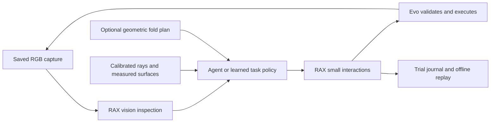

# Cloth primitives and robot trials

Keep task decisions in RAX. Evo owns robot state, trajectory validation, command
ownership, recording readiness, and stops. No cloth model runs in Evo.



Use `api.cloth_actions.ClothActions` to build a task one interaction at a time.
It does not require rectangle corners or the geometric planner. An external
learned policy can choose targets and use the same interface.

| Method | Result or purpose |
|---|---|
| `observe` | Save a new RGB capture through `evo_observe` |
| `inspect` | Ask the configured Gemini tool for checks and pixel candidates |
| `move` | Preview and execute left and/or right palm targets in `base_link` |
| `grip` | Set a measured finger angle and retention flag |
| `lift` | One vertical increment, at most 0.04 m |
| `spread_increment` | Increase hand separation by at most 0.04 m |
| `release_checked` | Require fresh named visual checks, then open one hand |

Motion results describe the robot. They do not prove grasp retention, layer
capture, alignment, or task success. Obtain a new observation after each
interaction. Do not use evidence from before the latest motion for release.
For two-hand release, inspect again between releases. Use a separate live Context
for `evo_hold` or `evo_cancel`; do not queue stops behind model calls or journal I/O.

## Vision and metric geometry

`api.cloth_vision.ClothVision` uses the existing budgeted `gemini_generate` tool.
It sends saved JPEG bytes with camera labels, capture times, and image dimensions.
It requires a structured result tied to that capture. The model returns state,
`verified`, `failed`, or `unknown` checks, supporting text, and pixel candidates.
It cannot return motion commands or metric positions. This is a general vision
model adapter, not a trained towel policy. It requires the frontend vision tool
to be configured. It has no fallback that fabricates observations.

```python
from api.runtime import Context
from api.cloth_actions import ClothActions

with Context() as context:
    cloth = ClothActions(context, workspace=".")
    capture = cloth.observe()
    evidence = cloth.inspect(capture, ["left grasp holds cloth", "packet supported"])
    print(evidence.data)  # An uncertain result is useful evidence.
    # Choose the next interaction from this evidence and measured geometry.
```

`Assessment.locate(context, candidate_id)` uses two corresponding calibrated
camera rays. A single ray requires an explicit measured plane and
`verified_on_surface=True`. Never use a table plane for a suspended or crumpled
point. Missing calibration is an error. The model's confidence and the ray
intersection residual are not calibrated grasp uncertainty estimates. Measure
the contact-to-palm offset separately. Use SI units and xyzw quaternions.

`Assessment.require` and `locate` reject old captures. The default age limit is
five seconds. A slow model response can therefore be useful for analysis but
unsuitable for a release check. Improve capture/inference latency before physical
use; do not treat an expired capture as current evidence.

The existing `api.cloth.Cloth` recipes still accept a task-specific
`perceive(observation, check) -> Scene` function. Use the vision adapter for visual
checks and a measured estimator for metric fields. The adapter does not invent a
complete `Scene` from RGB. A desired `check.target` is a goal, not evidence.

## Optional geometric baseline

`api.towel_planner` contains a pure rectangular half-fold planner. It has no
transport or robot dependencies. It uses a quasi-static, zero-thickness gravity
fold model, inspired by [the geometric cloth-folding paper](https://goldberg.berkeley.edu/pubs/WAFR-2010-Clothfolding.pdf).
Its test lift and transfer use the available material length. The recipe checks
the measured half-size footprint, support, stability, retained grips, and alignment
before release. It checks the result again after release. Pile placement chooses
a fitting equivalent rectangle orientation with the smallest turn.

This is a baseline for comparison. It does not model friction, thickness, wrinkles,
slip, or cloth dynamics. Learned strategies can bypass it and use `ClothActions`
or `Evo.execute`. Do not add cloth-specific constraints to Evo to enforce it.

## Trial records and replay

Wrap an existing Context with `api.cloth_trial.TrialContext(context, directory,
workspace=...)`. Use a new directory for each trial. The wrapper writes each
request before dispatch. It saves results, errors, image bytes, hashes, and
capture metadata. Use `annotate(outcome, note)` for operator judgments. An I/O or
tool error prevents further calls through that wrapper. Keep the underlying
Context available for stops. Close the journal after the trial.

`ReplayContext(directory)` needs no live Context. It checks exact tool names and
arguments, returns recorded values, and refuses mismatches, incomplete logs,
changed images, and calls after the trace ends. It never resumes robot motion.
Use the trial directory as the vision workspace when inspecting archived images.
Original timestamps remain intact: offline evidence cannot pass current-state
release checks. Replay reproduces a recorded call trace; it is not a cloth simulator.

Start physical development with one interaction per trial: pick, inspect retention,
small lift, small spread, supported placement, release, then packet transport.
Record the camera view, tool offset, towel type, action parameters, and outcome.
Use failures to revise the interaction and its checks. Compare the geometric
baseline and learned policies on the same captures and outcome definitions.
Only then compose longer unfold, fold, and stack tasks.
