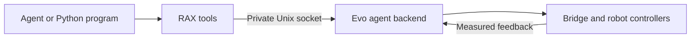
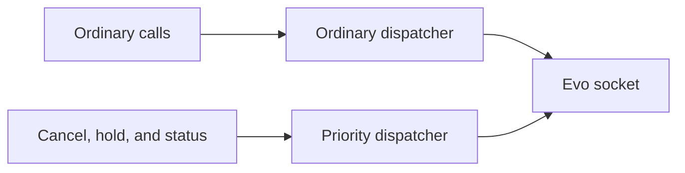
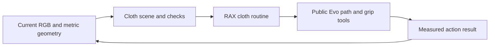
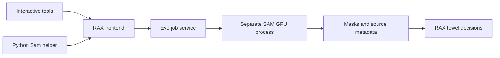
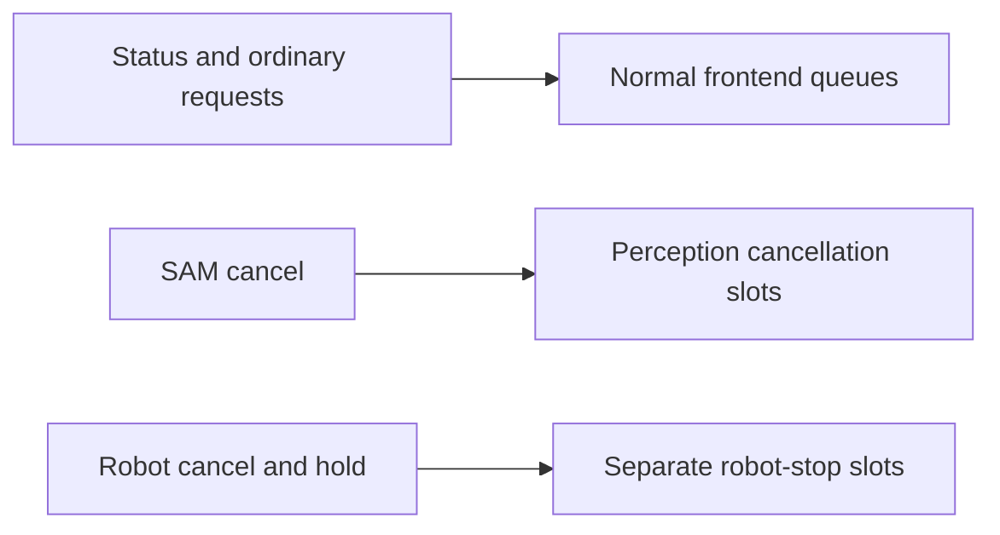

# Evo v3 backend

RAX uses the versioned Evo agent backend in `evo_orchestrator`. The Python adapter
owns tool schemas, local transport, image files, and result formatting. Evo owns
arming checks, command ownership, limits, model checks, action execution, and
measured stop results. This follows the [RAX system interface](https://arxiv.org/html/2610.22496#S4).



The adapter exposes discovery, RGB observation and history, FK, IK, preview, camera
rays, arm motion, grippers, carriage, neck, bounded base velocity, action status,
cancellation, and hold. Optional calibrated scene control adds measured base moves,
button detections, and local doorway traversal. See [elevator primitives](docs/evo/ELEVATOR_PRIMITIVES.md)
for the API, configuration, and qualification limits. RAX task schemas are in `services/evo/elevator_tools.json`.
`services/evo/tools.json` contains the generic Evo schema. It is
identical to Evo's `evo_agent_backend/contract/tools.json`. The old towel socket and
EVJ1 transport are removed; there is no fallback.

Use SI units and named joints. Gripper positions are radians (`position_rad`).
Carriage position is metres (`position_m`). Cartesian targets name `base_link` or
`carriage_link`. Quaternion order is `[x, y, z, w]`. Force control, arm-to-scene
collision checks, and general navigation are unavailable. Optional point-cloud
base control is reported under `scene` in capabilities. Missing camera calibration
leaves metric image geometry unavailable.

The operator must start Evo's explicit exclusive agent profile and set its trusted
`session_root` to the directory that directly contains RAX sessions. The usual RAX
layout is `$RAX_ARTIFACT_ROOT/sessions/<session>`. Keep this artifact root outside
the private Evo runtime directory; the sandbox hides that complete directory. The existing dashboard and operator
arm/disarm controls write `<session>/operator/armed.json`. Evo reads this file
independently. Neither arming nor controller configuration is an agent tool.

Operator `backend_options` are `control_socket` and `socket_timeout_s`.
Optional elevator services are configured in Evo under `evo_agent_backend.elevator`. The default
socket is `~/.local/evo/agent/agent.sock`. Configure the exact runtime socket when
using an isolated simulation. Unknown options are refused. The launcher hides the
Evo socket, runtime files, Evo workspace, and session operator directory from the
agent sandbox.

An action returns `action_id` and `state: accepted`. Poll `evo_action_status` for a
terminal result. `evo_cancel` and `evo_hold` request a stop. Inspect
`physical_stop_verified` before treating the robot as stopped. A lost or malformed
motion response removes the adapter's lease; the adapter never retries that action.

```python
from api.runtime import Context
from api.evo import Evo

with Context() as ctx:
    state = ctx.value("evo_status")
    action = {"kind": "move_neck", "yaw_rad": 0.1, "pitch_rad": 0.0}
    ctx.value("evo_preview", action=action)
    result = Evo(ctx).move("evo_move_neck", yaw_rad=0.1, pitch_rad=0.0)
    assert result["state"] == "succeeded" and result["physical_stop_verified"]
```

These calls use the same MCP interface as interactive agent calls. Operator arming
and fresh measured state are still required. Evo cancel, hold, and status calls
use a separate frontend dispatcher. A slow observation, model call, or image
reader cannot occupy that dispatcher. A competing ordinary request is refused
as busy; it cannot remain queued and start motion after a stop. A Python program must use a separate
`Context` connection to stop an action while another call is pending.



Base action duration starts when Evo sends the first velocity command. A delayed
first control tick cannot turn an unsent action into a successful result. Gripper
tool descriptions and parameters both specify radians. `evo_history` returns a bounded image index and can retrieve a capture by
`observation_id`, including its original timestamp and measured state.

The dedicated Evo simulation profile uses mock actuators, the existing controllers,
and camera fixtures. Run the complete-path test after starting that isolated profile:

```sh
EVO_AGENT_TEST_SOCKET=/absolute/simulation/agent/agent.sock \
EVO_AGENT_TEST_SESSION_ROOT=/absolute/simulation-rax/sessions \
python -m pytest -q local_tests/integration/test_evo_agent_runtime.py
```

The test refuses to arm a runtime unless Evo reports simulated actuator modes.
The complete-path checks passed on ARM64 Linux with all actuator groups, a Python
program, cancellation, disarm, lease loss, recorder loss, restart, and shutdown.
See `local_tests/README.md` for the optional failure and restart checks.
Simulation establishes software behavior. Physical stopping and task qualification
remain separate work.

## Cloth routines

The public interface now includes `evo_move_body`, `evo_follow_path`, `evo_move_pair`,
and `evo_set_grip`. Path waypoints share timing across selected hands and body
joints. Preview and execution check all generated samples. Segments use smooth
progress and stop at each waypoint. Grip targets persist during normal actions
while operator arming, measured feedback, recording, and the client lease remain
valid. A retained command is not evidence that cloth is held.

The [composable primitive guide](CLOTH_PRIMITIVES.md) describes model-assisted
inspection, small interactions, and trial record/replay. These live entirely in
RAX. The geometric planner is optional; learned policies can use the same motion
interface without it.

The [cloth handling instructions](agent_skills/control/evo-v3/cloth-handling/SKILL.md)
describe the Python routines for crumpled towel unfolding, measured half-folds,
and folded packet stacking. A task perception function must supply current metric
geometry and cloth checks. The library includes calibrated ray triangulation and
measured-plane helpers; it does not include a trained cloth detector. Each routine
stops on uncertain grasp, layer, support, or alignment evidence. The unfold loop
has a finite attempt budget. A failed handover does not release the source hand.



The cloth workflow tests use explicit perception fixtures. They check sequencing,
geometry refusal, bounded retries, complete-packet checks, and release conditions.
They do not simulate cloth mechanics or qualify physical folding performance.
The complete-path mock test also runs the cloth program through the frontend
socket, with the native model, bridge, and measured mock controllers.

| Verification on Linux ARM64 | Result |
|---|---|
| RAX unit suite with composable cloth primitives | 278 passed, 4 skipped |
| Public actuator and cloth-program path | Passed |
| Frontend cancel/hold during blocked observation | Passed for base and arm paths |
| Shared protocol contract | No changes in this cloth update |

The skipped tests require the optional rby1-sdk or FFmpeg dependencies, which
were not available in this test environment. The
operator trial code is kept outside the backend and is not an agent fallback.

## Earlier trial evidence

Stop requests (`evo_cancel`, `evo_hold`) have separate frontend admission and do not wait for status calls or frontend audit storage. Evo records stop requests and action outcomes in its event log. If a stop RPC fails or is refused, RAX stops lease renewal; Evo then stops the action on lease expiry. Start a new session before further motion.

The sections below describe earlier perception trials and the replaced observation
transport. They do not qualify the new motion backend.

## Trial lessons

The local towel trial compared six held-out frames per view. The lower image-edge
height was more stable than the four corner intersections. These are standard deviations
in corrected pixels, not metric error or independent accuracy.

| View | SAM line height | Gradient line height | Gradient accepted |
|---|---:|---:|---:|
| Head | 0.071 | 0.082 | 6/6 |
| Left wrist | 0.171 | unavailable | 0/6 |
| Right wrist | 0.238 | 0.066 | 4/6 |

Use the original SAM line as the baseline. Do not replace every camera with gradient
refinement. Temporal optical flow is not cross-camera triangulation. The reusable Evo
trial evaluator is `packages/evo_towel_folding/tools/evaluate_trial_geometry.py`.
No successful physical alignment or folding skill is claimed.


## Google Gemini

The launcher accepts `--gemini-provider google --gemini-key-file /absolute/private/key`.
The host reads the key; it is not copied into the agent workspace. The Google transport
uses the [documented OpenAI-compatible endpoint](https://ai.google.dev/gemini-api/docs/openai)
and the fixed model `gemini-3.8-flash`, with the existing bounded inline-image contract.
It refuses redirects and unsupported OpenRouter reasoning parameters. No remote image
URLs are fetched. Google does not return billed USD through this interface: the harness
retains its full cost reservation, which is an estimate, not a provider-enforced price
ceiling. Use provider-side quotas for an actual billing cap.

A single image-check trial was explicitly approved for three recorded camera images.
It took 13.18 s and reported 4654 total tokens. The model identified the towel in all
views but flagged shallow wrist views and gripper-pad ambiguity. This is semantic
inspection evidence, not metric geometry or a clearance certificate. Do not infer
permission to upload other scenes from this approval.

## Live adapter trial

The adapter captured 12 complete three-camera observations without motion, with maximum
capture skew 40.121 ms. MCAP on the robot: `2026-10-20T22-53Z_run-0000`.
Frames and metadata remain local under the ignored artifact root. The policy-status
socket was not tested live because the robot still ran the separate recovery runtime.
Status and cancellation were tested with a mock Unix socket. No RAX motion ran.

Frozen candidate ROIs gave 12/12 accepted head fits, 12/12 left fits, and 9/12 right
fits in this new capture. SAM line-height standard deviations were 0.111, 0.137,
and 0.186 pixels respectively. Gradient refinement accepted 11/12, 0/12, and 8/12;
its spreads were 0.082, unavailable, and 0.234 pixels. The earlier right-wrist benefit
did not repeat. Keep refinement as a diagnostic, not a promoted control primitive.

Reusable skills live in `agent_skills/control/evo-v3/` and
`agent_skills/perception/rgb-only-evo-v3/`. They render into each new RAX workspace.

## Preserved operator trials

[Earlier arm-step and J4 hold trials](docs/evo_trials_2026_10_20.md) retain the
recordings, measured errors, and first observed failures from the target branch.
Their diagnostic code is in `operator_trials/`. The exclusive backend replaces
those agent-facing sockets and tools. It does not expose hardware parameter
changes or hold-correction pulses to the agent. The recorded physical tracking
problems remain unqualified by the mock-controller tests.

## SAM 3.1 tools

SAM inference and assets live in Evo. This client only forwards jobs, validates
artifacts, and saves them in the workspace. It has no SAM or Triton dependency.
The four tools are registered for interactive calls and Python programs.



```python
from api.runtime import Context
from api.sam import Sam
from api.cloth_trial import TrialContext

with Context() as ctx:
    trial = TrialContext(ctx, "trials/towel-001")
    try:
        observation = trial.value("evo_observe")
        sam = Sam(trial)
        result = sam.wait(sam.segment(observation["observation_id"], camera="base"))
        # Inspect result["frames"][0]["overlay"]["path"] and select a candidate.
        # Use separate task evidence before planning a grasp or fold.
    finally:
        trial.close()
```

The trial log saves source captures even when they were captured before the trial.
Replay verifies image and mask hashes and never opens a robot connection. Clips
are limited to 64 ordered frames over 10 seconds. Default coordinates are captured
pixels. Rectified results retain calibration and an explicit pixel-space label;
convert them back before use with captured-pixel ray tools. Detection alone cannot
establish metric geometry, grasp retention, layers, or success.

The native video profile uses different thresholds from the image profile. Empty
tracking frames are expected when the model loses evidence. Do not fill those gaps
with a claim that a grasp or towel identity remains valid.

### Text tracking during cloth motion

Choose a prompt from visible evidence. For example, use
`sam.track(capture_ids, camera="base", prompt="red towel")` for a red target.
Review the masks before using them in a task. If text does not select the intended
object, use a positive point inside it and negative points on distractors in the
first frame. Do not infer that an absent mask means the object has left the scene.

Evo video profile `sam31-native-video-1008-2026-10-22.3` uses a lower threshold to
match detections to existing tracks. Its higher new-track threshold and upstream
occlusion/removal rules stay in place. Prompt selection and task decisions remain
in RAX. The client does not tune model thresholds or fill missing masks.

| Saved-clip check | Earlier result | Current result |
|---|---:|---:|
| Original short text clip | 13 / 16 target frames | 16 / 16 target frames |
| Red towel lift, generic prompt | 36 / 48 | 46 / 48 |
| Red towel with partial occlusion, generic prompt | 19 / 48 | 19 / 48 |
| Same partial-occlusion clip, `red towel` prompt | — | 48 / 48 |
| White towel lift | 40 / 40 | 40 / 40 |
| White towel fold | 32 / 32 | 32 / 32 |

The longer clips span about nine seconds. Counts refer to the reviewed target ID;
they are not pixel accuracy or task success. A separate synthetic full-occlusion
control returned no masks during the hidden interval and resumed the target ID
afterwards. This does not establish identity through real complete occlusion.
See Evo's `packages/evo_sam/tracking-motion-2026-10-22.md` for source manifests,
threshold comparisons, and limits. PNG output size can require fewer frames even
when a clip is below the frame-count and duration limits.


SAM cancellation bypasses frontend status calls and audit writes. It has separate
admission slots from robot cancel and hold, so blocked perception cancellations
cannot consume the robot-stop slots. It does not acquire or revoke motion authority.



`Sam.wait(timeout_s=...)` checks its deadline after status and frame responses.
It requests cancellation and raises `TimeoutError` instead of returning a late
result. A cancellation failure is reported as the cause. The helper does not
interrupt an in-flight synchronous socket call; use a separate `Context` for
urgent cancellation. Cancelling an already completed job does not erase its
successful terminal state.


The explicit elevator settings also support `reverse_exit=True`. Entry keeps
its normal approach. Exit aligns the rear to the aperture and uses the same
bounded staging and full-footprint crossing checks. This option can avoid a
turn inside the cabin. It requires fresh doorway geometry and a valid swept
path behind the robot; missing rear floor or obstacle evidence must refuse in
the native preview. The default remains a forward exit after turning.
