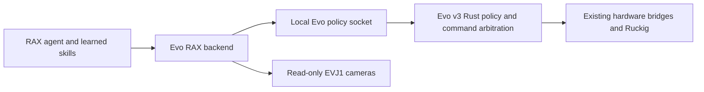

# Evo v3 adaptation

This branch starts from upstream `real/rainbow` at
`36c926ca3cf15921c6fc746a4bf309c26b0aa3c4`. The
[real-robot adaptation guide](https://github.com/robot-agent-exploration/rax/blob/2652c73f51514cbb84ef0fdf5a8aee2ba5b53fb7/docs/REAL_ROBOT_ADAPTATION.md)
is the design reference. Rainbow code remains as an explicit reference backend; new
sessions default to `evo-v3` and RGB-only. No Rainbow numbers qualify Evo motion.

## Implemented contract

| Tool | Effect | Limitation |
|---|---|---|
| `evo_status` | Read existing towel-policy status | Not a measured robot-state snapshot |
| `evo_observe` | Save coherent, fresh camera JPEGs and metadata | No validated extrinsics or capture-time joints yet |
| `evo_hold` | Request towel-policy cancellation | Not a global stop; acknowledgement is not stop verification |

The backend runs beside Evo on the robot. It has operator-configured local paths, no
shell command transport, no ROS publisher, and no hardware SDK. Camera errors are
returned individually. Frames older than the configured age, future timestamps,
unstable generations and malformed payloads are refused. Construction and close while
idle command nothing. Files are published by rename. Raw frames are full-resolution;
preview downscaling remains pending.

Use `python scripts/configure_session.py --robot evo-v3 --observation-profile rgb-only
--task towel_alignment --task-text 'Observe towel alignment; no motion.'` with the
harness dependencies installed. The inherited launcher is Claude-based; this branch
does not claim that a Codex launcher or sandbox qualification has been completed.

Operator `backend_options`: `control_socket`, `camera_directory`,
`camera_max_age_s` (default 0.3, maximum 1), `socket_timeout_s` (default 2, maximum 5).
The defaults use `/run/evo/towel-alignment.sock` and `/run/evo/camera-shm`.
Use the actual configured Evo socket path. Unknown options and tool fields are rejected.

## Evo integration

The existing Evo work is in `Kovari-Industries/evo`, branch
`benson/towel-alignment-gpu`, package `evo_towel_folding`. The Rust physical adapter
owns measured feedback, Ruckig transitions, bounded base corrections and MCAP events.
Keep the tested policy in Evo; RAX stores exploration decisions and reusable experience.

The current Evo socket has asynchronous `start`, `cancel`, and `status`. It does not
identify attempts. A start can fail before a client sees any intermediate state.
Therefore this adapter deliberately does not expose start: add attempt IDs, explicit
running/completed state, and a measured-stop result on the Evo side before wiring a
supervised action tool. Polling for a state transition alone can mistake an old result
for a new result or miss a fast refusal.

Next backend primitives, in order:
1. Capture-time joint/odometry snapshot and calibrated per-camera metadata from Evo.
2. Measured stop and attempt identity, then dry-run checks and supervised policy execution.
3. Characterized carriage/base actions through Evo arbitration, with cancellation and
   record-before-motion. No duplicate Python motor controller.
4. SAM as an optional perception service; image-edge and optical-flow diagnostics as
   separate read-only tools. Freeze settings for each evaluation trial.

## Trial lessons

The local towel trial compared six held-out frames per view. The lower image-edge
height was more stable than the four corner intersections. These are standard deviations
in corrected pixels, not metric error or independent accuracy.

| View | SAM line height | Gradient line height | Gradient accepted |
|---|---:|---:|---:|
| Head | 0.071 | 0.082 | 6/6 |
| Left wrist | 0.171 | unavailable | 0/6 |
| Right wrist | 0.238 | 0.066 | 4/6 |

Use the original SAM line as the baseline. Do not replace every camera with gradient
refinement. Temporal optical flow is not cross-camera triangulation. The reusable Evo
trial evaluator is `packages/evo_towel_folding/tools/evaluate_trial_geometry.py`.
No successful physical alignment or folding skill is claimed.

## Google Gemini

The launcher accepts `--gemini-provider google --gemini-key-file /absolute/private/key`.
The host reads the key; it is not copied into the agent workspace. The Google transport
uses the [documented OpenAI-compatible endpoint](https://ai.google.dev/gemini-api/docs/openai)
and the fixed model `gemini-3.8-flash`, with the existing bounded inline-image contract.
It refuses redirects and unsupported OpenRouter reasoning parameters. No remote image
URLs are fetched. Google does not return billed USD through this interface: the harness
retains its full cost reservation, which is an estimate, not a provider-enforced price
ceiling. Use provider-side quotas for an actual billing cap.

A single image-check trial was explicitly approved for three recorded camera images.
It took 13.18 s and reported 4654 total tokens. The model identified the towel in all
views but flagged shallow wrist views and gripper-pad ambiguity. This is semantic
inspection evidence, not metric geometry or a clearance certificate. Do not infer
permission to upload other scenes from this approval.

## Live adapter trial

The adapter captured 12 complete three-camera observations without motion, with maximum
capture skew 40.121 ms. MCAP on the robot: `2026-10-20T22-53Z_run-0000`.
Frames and metadata remain local under the ignored artifact root. The policy-status
socket was not tested live because the robot still ran the separate recovery runtime.
Status and cancellation were tested with a mock Unix socket. No RAX motion ran.

Frozen candidate ROIs gave 12/12 accepted head fits, 12/12 left fits, and 9/12 right
fits in this new capture. SAM line-height standard deviations were 0.111, 0.137,
and 0.186 pixels respectively. Gradient refinement accepted 11/12, 0/12, and 8/12;
its spreads were 0.082, unavailable, and 0.234 pixels. The earlier right-wrist benefit
did not repeat. Keep refinement as a diagnostic, not a promoted control primitive.

Reusable skills live in `agent_skills/control/evo-v3/` and
`agent_skills/perception/rgb-only-evo-v3/`. They render into each new RAX workspace.
