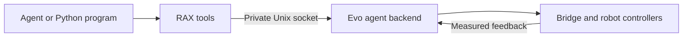
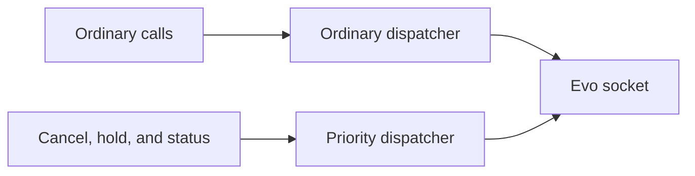

# Evo v3 backend

RAX uses the versioned Evo agent backend in `evo_orchestrator`. The Python adapter
owns tool schemas, local transport, image files, and result formatting. Evo owns
arming checks, command ownership, limits, model checks, action execution, and
measured stop results. This follows the [RAX system interface](https://arxiv.org/html/2610.22496#S4).



The adapter exposes discovery, RGB observation and history, FK, IK, preview, camera
rays, arm motion, grippers, carriage, neck, bounded base velocity, action status,
cancellation, and hold. `services/evo_v3/tools.json` is the public schema. It is
identical to Evo's `evo_agent_backend/contract/tools.json`. The old towel socket and
EVJ1 transport are removed; there is no fallback.

Use SI units and named joints. Gripper positions are radians (`position_rad`).
Carriage position is metres (`position_m`). Cartesian targets name `base_link` or
`carriage_link`. Quaternion order is `[x, y, z, w]`. Depth, force control, scene
collision checks, and navigation are unavailable. Missing camera calibration
leaves metric geometry unavailable.

The operator must start Evo's explicit exclusive agent profile and set its trusted
`session_root` to the directory that directly contains RAX sessions. The usual RAX
layout is `$RAX_ARTIFACT_ROOT/sessions/<session>`. Keep this artifact root outside
the private Evo runtime directory; the sandbox hides that complete directory. The existing dashboard and operator
arm/disarm controls write `<session>/operator/armed.json`. Evo reads this file
independently. Neither arming nor controller configuration is an agent tool.

Operator `backend_options` are `control_socket` and `socket_timeout_s`. The default
socket is `~/.local/evo/agent/agent.sock`. Configure the exact runtime socket when
using an isolated simulation. Unknown options are refused. The launcher hides the
Evo socket, runtime files, Evo workspace, and session operator directory from the
agent sandbox.

An action returns `action_id` and `state: accepted`. Poll `evo_action_status` for a
terminal result. `evo_cancel` and `evo_hold` request a stop. Inspect
`physical_stop_verified` before treating the robot as stopped. A lost or malformed
motion response removes the adapter's lease; the adapter never retries that action.

```python
from api.runtime import Context
from api.evo import Evo

with Context() as ctx:
    state = ctx.value("evo_status")
    action = {"kind": "move_neck", "yaw_rad": 0.1, "pitch_rad": 0.0}
    ctx.value("evo_preview", action=action)
    result = Evo(ctx).move("evo_move_neck", yaw_rad=0.1, pitch_rad=0.0)
    assert result["state"] == "succeeded" and result["physical_stop_verified"]
```

These calls use the same MCP interface as interactive agent calls. Operator arming
and fresh measured state are still required. Evo cancel, hold, and status calls
use a separate frontend dispatcher. A slow observation, model call, or image
reader cannot occupy that dispatcher. A competing ordinary request is refused
as busy; it cannot remain queued and start motion after a stop. A Python program must use a separate
`Context` connection to stop an action while another call is pending.



Base action duration starts when Evo sends the first velocity command. A delayed
first control tick cannot turn an unsent action into a successful result. Gripper
tool descriptions and parameters both specify radians. The Evo history skill
describes state and observation metadata; it does not advertise image playback.

The dedicated Evo simulation profile uses mock actuators, the existing controllers,
and camera fixtures. Run the complete-path test after starting that isolated profile:

```sh
EVO_AGENT_TEST_SOCKET=/absolute/simulation/agent/agent.sock \
EVO_AGENT_TEST_SESSION_ROOT=/absolute/simulation-rax/sessions \
python -m pytest -q local_tests/integration/test_evo_agent_runtime.py
```

The test refuses to arm a runtime unless Evo reports simulated actuator modes.
The complete-path checks passed on ARM64 Linux with all actuator groups, a Python
program, cancellation, disarm, lease loss, recorder loss, restart, and shutdown.
See `local_tests/README.md` for the optional failure and restart checks.
Simulation establishes software behavior. Physical stopping and task qualification
remain separate work.

## Earlier trial evidence

Stop requests (`evo_cancel`, `evo_hold`) have separate frontend admission and do not wait for status calls or frontend audit storage. Evo records stop requests and action outcomes in its event log. If a stop RPC fails or is refused, RAX stops lease renewal; Evo then stops the action on lease expiry. Start a new session before further motion.

The sections below describe earlier perception trials and the replaced observation
transport. They do not qualify the new motion backend.

## Trial lessons

The local towel trial compared six held-out frames per view. The lower image-edge
height was more stable than the four corner intersections. These are standard deviations
in corrected pixels, not metric error or independent accuracy.

| View | SAM line height | Gradient line height | Gradient accepted |
|---|---:|---:|---:|
| Head | 0.071 | 0.082 | 6/6 |
| Left wrist | 0.171 | unavailable | 0/6 |
| Right wrist | 0.238 | 0.066 | 4/6 |

Use the original SAM line as the baseline. Do not replace every camera with gradient
refinement. Temporal optical flow is not cross-camera triangulation. The reusable Evo
trial evaluator is `packages/evo_towel_folding/tools/evaluate_trial_geometry.py`.
No successful physical alignment or folding skill is claimed.


## Google Gemini

The launcher accepts `--gemini-provider google --gemini-key-file /absolute/private/key`.
The host reads the key; it is not copied into the agent workspace. The Google transport
uses the [documented OpenAI-compatible endpoint](https://ai.google.dev/gemini-api/docs/openai)
and the fixed model `gemini-3.8-flash`, with the existing bounded inline-image contract.
It refuses redirects and unsupported OpenRouter reasoning parameters. No remote image
URLs are fetched. Google does not return billed USD through this interface: the harness
retains its full cost reservation, which is an estimate, not a provider-enforced price
ceiling. Use provider-side quotas for an actual billing cap.

A single image-check trial was explicitly approved for three recorded camera images.
It took 13.18 s and reported 4654 total tokens. The model identified the towel in all
views but flagged shallow wrist views and gripper-pad ambiguity. This is semantic
inspection evidence, not metric geometry or a clearance certificate. Do not infer
permission to upload other scenes from this approval.

## Live adapter trial

The adapter captured 12 complete three-camera observations without motion, with maximum
capture skew 40.121 ms. MCAP on the robot: `2026-10-20T22-53Z_run-0000`.
Frames and metadata remain local under the ignored artifact root. The policy-status
socket was not tested live because the robot still ran the separate recovery runtime.
Status and cancellation were tested with a mock Unix socket. No RAX motion ran.

Frozen candidate ROIs gave 12/12 accepted head fits, 12/12 left fits, and 9/12 right
fits in this new capture. SAM line-height standard deviations were 0.111, 0.137,
and 0.186 pixels respectively. Gradient refinement accepted 11/12, 0/12, and 8/12;
its spreads were 0.082, unavailable, and 0.234 pixels. The earlier right-wrist benefit
did not repeat. Keep refinement as a diagnostic, not a promoted control primitive.

Reusable skills live in `agent_skills/control/evo-v3/` and
`agent_skills/perception/rgb-only-evo-v3/`. They render into each new RAX workspace.
