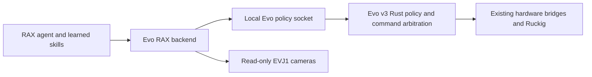

# Evo v3 adaptation

This branch starts from upstream `real/rainbow` at
`36c926ca3cf15921c6fc746a4bf309c26b0aa3c4`. The
[real-robot adaptation guide](https://github.com/robot-agent-exploration/rax/blob/2652c73f51514cbb84ef0fdf5a8aee2ba5b53fb7/docs/REAL_ROBOT_ADAPTATION.md)
is the design reference. Rainbow code remains as an explicit reference backend; new
sessions default to `evo-v3` and RGB-only. No Rainbow numbers qualify Evo motion.

## Implemented contract

| Tool | Effect | Limitation |
|---|---|---|
| `evo_status` | Read existing towel-policy status | Not a measured robot-state snapshot |
| `evo_observe` | Save coherent, fresh camera JPEGs and metadata | No validated extrinsics or capture-time joints yet |
| `evo_hold` | Request towel-policy cancellation | Not a global stop; acknowledgement is not stop verification |
| `evo_towel_align` | Run one configured, identified attempt | Off by default; requires operator enablement, arming and Evo protocol v2 |

The backend runs beside Evo on the robot. It has operator-configured local paths, no
shell command transport, no ROS publisher, and no hardware SDK. Camera errors are
returned individually. Frames older than the configured age, future timestamps,
unstable generations and malformed payloads are refused. Construction and close while
idle command nothing. Files are published by rename. Raw frames are full-resolution;
preview downscaling remains pending.

Use `python scripts/configure_session.py --robot evo-v3 --observation-profile rgb-only
--task towel_alignment --task-text 'Observe towel alignment; no motion.'` with the
harness dependencies installed. The inherited launcher is Claude-based; this branch
does not claim that a Codex launcher or sandbox qualification has been completed.

Operator `backend_options`: `control_socket`, `camera_directory`,
`camera_max_age_s` (default 0.3, maximum 1), `socket_timeout_s` (default 2, maximum 5).
The defaults use `/run/evo/towel-alignment.sock` and `/run/evo/camera-shm`.
Use the actual configured Evo socket path. Unknown options and tool fields are rejected.

## Evo integration

The existing Evo work is in `Kovari-Industries/evo`, branch
`benson/towel-alignment-gpu`, package `evo_towel_folding`. The Rust physical adapter
owns measured feedback, Ruckig transitions, bounded base corrections and MCAP events.
Keep the tested policy in Evo; RAX stores exploration decisions and reusable experience.

The updated Evo socket returns `evo.towel.control.v2` with a runtime session identity,
requested/completed attempt numbers, running status, a cancellation latch and stop proof.
`evo_towel_align` requires `enable_alignment: true` in operator backend options and
operator arming. It checks arming while polling and accepts completion only for the
same attempt after a verified stop. Old runtimes fail before start. A busy refusal does
not cancel another attempt. Unknown start outcomes are never retried; cancellation is
requested once, and acknowledgement is not reported as a measured stop.

This is a local candidate contract, not deployed robot acceptance. The robot's recovery
runtime remains separate. Camera geometry commissioning and deployment are still needed.
Poll interval defaults to 0.1 s, socket timeout to 2 s, and attempt timeout to 125 s;
these are configured bounds, not measured stop latency. There is no agent-process
heartbeat lease in Evo yet: process death leaves the autonomous policy under Evo's own
bounded lifetime. Do not claim immediate cancellation on RAX process loss.

Next backend primitives, in order:
1. Capture-time joint/odometry snapshot and calibrated per-camera metadata from Evo.
2. Deploy and qualify the new attempt contract, then dry-run checks and supervised policy execution.
3. Characterized carriage/base actions through Evo arbitration, with cancellation and
   record-before-motion. No duplicate Python motor controller.
4. SAM as an optional perception service; image-edge and optical-flow diagnostics as
   separate read-only tools. Freeze settings for each evaluation trial.

## Trial lessons

The local towel trial compared six held-out frames per view. The lower image-edge
height was more stable than the four corner intersections. These are standard deviations
in corrected pixels, not metric error or independent accuracy.

| View | SAM line height | Gradient line height | Gradient accepted |
|---|---:|---:|---:|
| Head | 0.071 | 0.082 | 6/6 |
| Left wrist | 0.171 | unavailable | 0/6 |
| Right wrist | 0.238 | 0.066 | 4/6 |

Use the original SAM line as the baseline. Do not replace every camera with gradient
refinement. Temporal optical flow is not cross-camera triangulation. The reusable Evo
trial evaluator is `packages/evo_towel_folding/tools/evaluate_trial_geometry.py`.
No successful physical alignment or folding skill is claimed.

## Google Gemini

The launcher accepts `--gemini-provider google --gemini-key-file /absolute/private/key`.
The host reads the key; it is not copied into the agent workspace. The Google transport
uses the [documented OpenAI-compatible endpoint](https://ai.google.dev/gemini-api/docs/openai)
and the fixed model `gemini-3.8-flash`, with the existing bounded inline-image contract.
It refuses redirects and unsupported OpenRouter reasoning parameters. No remote image
URLs are fetched. Google does not return billed USD through this interface: the harness
retains its full cost reservation, which is an estimate, not a provider-enforced price
ceiling. Use provider-side quotas for an actual billing cap.

A single image-check trial was explicitly approved for three recorded camera images.
It took 13.18 s and reported 4654 total tokens. The model identified the towel in all
views but flagged shallow wrist views and gripper-pad ambiguity. This is semantic
inspection evidence, not metric geometry or a clearance certificate. Do not infer
permission to upload other scenes from this approval.

## Live adapter trial

The adapter captured 12 complete three-camera observations without motion, with maximum
capture skew 40.121 ms. MCAP on the robot: `2026-10-20T22-53Z_run-0000`.
Frames and metadata remain local under the ignored artifact root. The policy-status
socket was not tested live because the robot still ran the separate recovery runtime.
Status and cancellation were tested with a mock Unix socket. No RAX motion ran.

Frozen candidate ROIs gave 12/12 accepted head fits, 12/12 left fits, and 9/12 right
fits in this new capture. SAM line-height standard deviations were 0.111, 0.137,
and 0.186 pixels respectively. Gradient refinement accepted 11/12, 0/12, and 8/12;
its spreads were 0.082, unavailable, and 0.234 pixels. The earlier right-wrist benefit
did not repeat. Keep refinement as a diagnostic, not a promoted control primitive.

Reusable skills live in `agent_skills/control/evo-v3/` and
`agent_skills/perception/rgb-only-evo-v3/`. They render into each new RAX workspace.

### Attempt lifecycle verification

Focused RAX tests cover old terminal results, fast refusal, runtime replacement,
connection loss, disarm, busy admission, and unversioned runtime rejection. Evo tests
cover pending cancellation, busy starts, reset of stop proof, and failed stop. No motion
has been issued through this new tool. The candidate Evo runtime is built separately;
RAX source alone cannot enable the required robot geometry or motion interfaces.

## Bounded RAX arm adapter trial

`evo_measured_state` and `evo_step` use the separate Rust `evo_rax_motion`
adapter in Evo's `evo_towel_folding` package. It publishes only on the existing
autonomy pose/gripper lanes. Evo retains arbitration, IK, Ruckig and hardware
control. The installed recovery runtime was preserved.

`motion_socket` defaults to `/run/evo/rax-motion.sock`; `enable_motion` defaults
to false. Start recording before enabling a trial. The transport checks session
arming during each call and closes the connection on disarm. The native adapter
withdraws its source on disconnect, fault or completion and checks measured
settling. A missing response never authorizes a retry. This is not a global stop.
The event JSONL is a recording sidecar; recorder activity is checked by the
trial operator, not enforced by the socket protocol.

Steps hold measured palm orientation, limit each translation to 3 cm and peak
speed to 1.5 cm/s, and bound gripper targets to [-0.6, 0] rad. Coordinates are
`carriage_link`, positive Z down. Completion requires measured tracking and
settling. These bounds do not establish collision clearance or contact targets.

The first live hold passed. A subsequent 2 cm upward step failed measured
settling: modeled palm positions moved about 4 mm downward. Motion was withdrawn
and stop was verified. No grasp or fold was attempted. The motion server was
then stopped. MCAP: jetson-105 `/home/benson/evo_bags/2026-10-20T23-09Z_run-0000`.
Task definition: `tasks/evo-v3/fold_towel_in_half.md`. Do not promote this
primitive as task-confirmed until the tracking error is resolved.

## Fixed-target J4 correction candidate

`evo_hold_correct({"arm":"left"})` runs one stationary baseline, the bounded
hardware-loop pulse from Evo #1230, and a retained-error observation after
withdrawal. `enable_hold_correction` defaults to false; session arming is also
required. Start MCAP before enabling the tool. It neither sets an arm pose nor
implements torque control in Python. All torque selection and fast guards stay
in the C++ hardware write loop. It refuses an enabled calibration session, non-default slew, or a driver
envelope that differs from the operator-configured profile. It stops on changed targets or unhealthy
feedback and does not retry failed pulses. This is a pilot, not five-pair
statistical acceptance or verified tool accuracy.

The new driver must be loaded before this tool can operate. Its installation
requires a controlled shutdown because the existing driver disables motors on
deactivation. The compiled overlay is separate from the active robot install.
No physical correction trial has been performed with this integration yet.

### First deployed hold pilot

The overlay loaded on jetson-105. MCAP `2026-10-20T23-26Z_run-0000`
contains startup, images and the first left J4 pilot. No added correction torque
was recorded; the driver ended with `predicted_target`. Withdrawal and measured
stop passed, and correction was disabled afterward. The towel was not touched.

Startup commanded J4 to 1.7 rad and settled at 1.672198 rad. IK then seeded from
measurement and published 1.672198 rad through the arm bridge. Thus the pilot
compared measurement with a newly held measured target, not the configured pose.
The original result incorrectly treated floating-point noise as improvement.
The evaluator now rejects a baseline below 0.001 rad before enabling correction;
improvement must exceed both 0.001 rad and 5% of baseline error. The raw pilot
result remains preserved with a separate corrected review.

Before another pilot, retain an explicit target through the authorized arm
command path and verify its identity during baseline and correction. Do not
claim the configuration error is fixed because a measured-pose hold has zero
tracking error. Base controller activation also failed during this restart;
resolve that before base motion. No full folding acceptance is established.

### Fold approach with hold assist

The 20 mm rise in MCAP `2026-10-20T23-31Z_run-0000` did not track.
Its left J4 pulse stopped when reported effort crossed 9 Nm (9.005 Nm recorded).
The generic driver reason was `invalid_hold_feedback`; do not interpret that
label alone as a communication fault.

An authorized retry used a 5 mm rise, with unchanged guards, in MCAP
`2026-10-20T23-35Z_run-0000`. Both pulses reached 1.5 Nm added torque and ended
at `pulse_timeout`. Left J4 did not move; right J4 moved one encoder count
(0.0003815 rad). Both measured stops and correction withdrawals passed. This is
not an effective correction at this pose. The towel was not grasped. Do not
repeat pulses or increase limits on the assumption that the earlier failure
was only a software admission problem.

### Attended peak profile

The operator requested the existing PR #1230 attended envelope for continued
fold trials. Set backend option `hold_profile: attended_peak` only with a driver
started with `calibration_overload_trial: true`. The default profile remains
`default`. A mismatch fails before enabling correction. The task cannot set an
arbitrary torque limit through a tool argument.

This uses the driver's existing ceiling below 15 Nm and cumulative exposure
below 30 seconds above 9 Nm per joint. Temperature, acquisition freshness,
target binding, cancellation and pulse caps remain active. The J4 pulse cap
stays 1.5 Nm for at most 2 seconds. Exposure spans normal motion and idle holds,
not just pulses. A trip is terminal for this attempt; do not restart to clear
its counter and continue. The separate attended deployment disables automatic
controller-manager restart. Motor-off restart still requires physical support.

Prepared robot manifest: `/data/rax-hold-1230/attended-config/manifest.yaml`.
Original manifest remains `/data/rax-hold-1230/config/manifest.yaml`.
At preparation time the default runtime is still active; no higher-torque
physical acceptance is claimed.

### Attended approach result

The attended peak profile was activated on both drivers after an operator-supported
restart. In MCAP `2026-10-20T23-42Z_run-0000`, one J4 pulse per arm after a
20 mm upward approach reduced retained encoder error from 3.26 to 1.66 degrees
on the left and 3.20 to 0.93 degrees on the right. Both pulses ended normally
at their duration limit and verified withdrawal and stop. Net modeled palm rise
was 8.46 mm left and 14.47 mm right; independent tool accuracy is not established.

The existing `ArmMotion.set_carriage` primitive then raised the carriage from
0.29596 to 0.34980 m in small measured waypoints with a fresh-feedback cancel
predicate, and verified stationary feedback. Images show the towel surface more
clearly, but no corner grasp or fold was attempted. The recorded initial step
still failed its original settling criterion before the assist; preserve that
first divergence. Do not describe this as a complete or task-confirmed fold.
