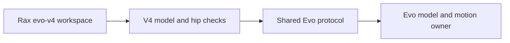

# Evo v4 backend

Select `--robot evo-v4` and `--observation-profile rgb-only`. This is a separate
robot registration from `evo-v3`. Shared protocol and elevator transport live in
`services/evo/`; the v4 adapter lives in `services/evo_v4/`.

The adapter checks for `hip_pitch_joint` and finite hip and carriage limits before
opening a motion session. Configured elevator travel must include the hip.
Limits come from the loaded model. The v4 workspace has its own robot facts and
control/perception skill layers. Existing private-runtime protections and measured
stop checks apply to this profile.

Initial validation is offline in ML's `packages/evo_isaac` v4 worktree. The pinned
v4 simulation fixes its finger joints and intermediate lift stage. It cannot
qualify gripper actuation, real tooling or hotel operation. No physical session
has been started. The target site is Hilton University of Houston; the historic
maps distinguish the guest elevator from garage elevators but have no metric scale.

## Offline requirement

The elevator task must run offline. Use stored Python task code, the local Evo
runtime and prepared model, detector and calibration files. Task execution must
not download files or call a cloud model. An online development session does not
change this runtime requirement. Set `gemini=False` when generating an offline
workspace. Do not start an agent provider to execute a stored elevator routine.

The v4 profile and elevator task tests also run under ML's existing
`run_offline.py` launcher, which blocks IPv4 and IPv6 sockets and permits the
private Unix-domain Evo interface. Native simulation uses the same boundary.
