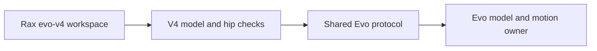

# Evo v4 backend

Select `--robot evo-v4` and `--observation-profile rgb-only`. This is a separate
robot registration from `evo-v3`. Shared protocol and elevator transport live in
`services/evo/`; the v4 adapter lives in `services/evo_v4/`.



The adapter checks for `hip_pitch_joint` and finite hip and carriage limits before
opening a motion session. Configured elevator travel must include the hip.
Limits come from the loaded model. The v4 workspace has its own robot facts and
control/perception skill layers. Existing private-runtime protections and measured
stop checks apply to this profile.

Initial validation is offline in ML's `packages/evo_isaac` v4 worktree. The pinned
v4 simulation fixes its finger joints and intermediate lift stage. It cannot
qualify gripper actuation, real tooling or hotel operation. No physical session
has been started. The target site is Hilton University of Houston; the historic
maps distinguish the guest elevator from garage elevators but have no metric scale.

## Offline requirement

The elevator task must run offline. Use stored Python task code, the local Evo
runtime and prepared model, detector and calibration files. Task execution must
not download files or call a cloud model. An online development session does not
change this runtime requirement. Set `gemini=False` when generating an offline
workspace. Do not start an agent provider to execute a stored elevator routine.

The v4 profile and elevator task tests also run under ML's existing
`run_offline.py` launcher, which blocks IPv4 and IPv6 sockets and permits the
private Unix-domain Evo interface. Native simulation uses the same boundary.

The native scene configuration now requires an explicit floor policy. A trusted
operator can select `expected_level_indoor` with a recorded site/basis; otherwise
select `measured`. Rax records the backend policy in base-action evidence and
continues to use native previews and measured stops. There is no task-side policy
setter or fallback around a refused obstacle, observed drop, raised sill, or
closing door. Poisson/CBF obstacle avoidance is deferred until the assembled
journey is qualified; the existing obstacle refusal remains active.

### Read-only sensor preparation

Use `api.sensor_probe.probe_sensors` through the existing `Context` before any
hardware motion. It calls only `evo_capabilities`, `evo_status`, `evo_observe`,
and optionally `rax_scene`. Pass an emitter that writes and flushes each JSON
row. Both started and finished rows are retained; an unavailable scene does not
prevent recording the next RGB sample. Use `include_scene=False` for an RGB-only
session, and record that depth is untested.

```python
import json
from api.runtime import Context
from api.sensor_probe import probe_sensors
with open('sensor-receipt.jsonl', 'x') as output, Context() as context:
    def emit(row):
        output.write(json.dumps(row, allow_nan=False) + '\n')
        output.flush()
    result = probe_sensors(context, emit, samples=10)
```

Call duration uses the client monotonic clock. Exposure times remain unchanged
inside the raw response. Do not calculate sensor age from client wall time until
the capture clock domain and offset are checked. A successful reply is not a
calibration result. This probe does not enable, disarm, move or configure the
robot, and does not claim RGB replies include raw depth.
