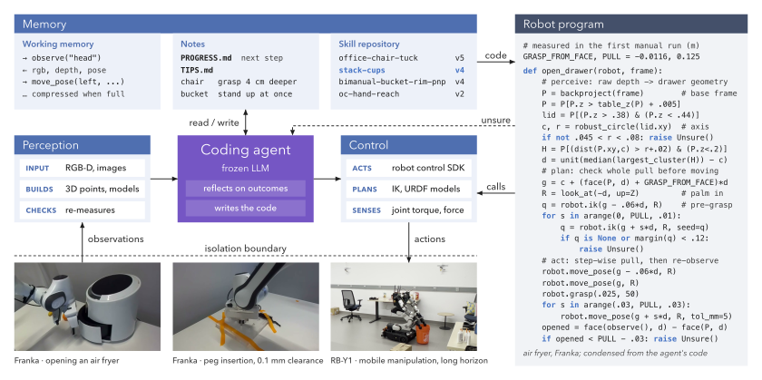

# RAX for Kovari Evo v3

This branch adds the Evo v3 backend. Read [EVO_V3.md](EVO_V3.md) for tools, tested limits, and rollout status. The inherited Rainbow documentation below is a reference, not Evo operating guidance.

# RAX on the Rainbow RB-Y1

**[Project website](https://robot-agent-exploration.com/)** · [Paper](https://robot-agent-exploration.com/rax.pdf) · [Main repository](https://github.com/robot-agent-exploration/rax)

This branch runs RAX (*RAX: Scaling Online Exploration for Robot Agents*) on a real
**Rainbow Robotics RB-Y1** (model A) mobile manipulator. A Claude Code agent learns a
task by exploring the robot through MCP tools: first by hand, then by writing and testing
its own code, with its perception checking the scene at the decisive points. The agent
runs on the host in Claude Code's sandbox; one trusted robot service owns the robot, and
the operator arms every motion.

The design principles and the porting steps for another robot are in the main
repository's [real-robot adaptation guide](https://github.com/robot-agent-exploration/rax/blob/main/docs/REAL_ROBOT_ADAPTATION.md).
Robot details, safety limits and what was measured on the robot: [RBY1.md](RBY1.md).
System map and setup lessons: [docs/rby1/SETUP_NOTES.md](docs/rby1/SETUP_NOTES.md).

> **This software moves a real robot.** Run it only with a person at the emergency stop,
> with the robot's workspace clear, and after the motion check below. Every motion tool
> refuses until the operator arms the session; the EMO buttons stay the outermost layer.

## How it fits together

```
 Claude Code (host process, cwd = <session>/agent-workspace)
   ├─ MCP stdio ── mcp_bridge.py ──┐
   └─ Bash (bubblewrap sandbox) ───┴─ Unix socket ── robot service (services/controller/frontend.py)
                                                       └─ Rby1Backend ── rby1_sdk ── gRPC ── controller (192.168.30.1)
 Claude Code ── http://127.0.0.1:<port> ── messages_relay.py (holds the model credential)
```

| Layer | What | Where |
|---|---|---|
| Backend (the robot) | MCP tools, safety checks, kinematics, cameras, live recording, dashboard telemetry | `services/rby1/`, registered in `services/backends.py` |
| Frontend (operator) | Dashboard: sessions, arming, operator requests, frames, live robot state | `services/dashboard/` |
| Harness | Workspace generator, agent instructions and skills, launcher, sandbox, relay, MCP frontend | `services/workspace/`, `auto_research_agent/`, `agent_skills/`, `harness/`, `services/controller/` |

- **One robot owner.** The robot service is the only process that commands the robot. It
  serializes every call from the agent CLI and the agent's scripts and writes an audit log
  (`mcp.jsonl`).
- **The workspace is the agent's only writable place.** Claude Code runs with
  `--permission-mode dontAsk`; Read and Edit reach only the workspace. Bash runs in Claude
  Code's sandbox: internet only through its proxy, which refuses the robot controller; no
  host loopback; writes only in the workspace; no access to this repository, credentials,
  the session's private files, docker/dbus/X11 sockets, or the paths you list in
  `RAX_PROTECTED_PATHS`.
- **No credentials in the agent.** A host relay injects the model credential. Gemini
  (`google/gemini-3.8-flash`, for checking images) is brokered by the robot service with a
  $10 cap per session.
- **Motion needs the operator.** Every motion tool refuses until the operator arms the
  session (`rby1 arm`, typing ARM). `rby1 disarm` stops a running motion within one
  control period, and the robot holds.

## Requirements

- **Robot:** RB-Y1 model A, controller firmware 0.8.0 (SDK commit `f3bb123`, v0.8.3),
  with its two Dynamixel grippers and the head ZED 2i.
- **UPC:** the robot's Jetson (aarch64, on the robot network 192.168.30.0/24), where the
  grippers and the head camera are connected over USB. Everything below runs there.
- **Software on that host:**
  - [Claude Code](https://docs.claude.com/en/docs/claude-code/setup) (`claude` on `PATH`);
  - `bubblewrap` and `socat` for Claude Code's sandbox (on Ubuntu 24.04, also an AppArmor
    profile that allows bwrap's user namespaces);
  - the [ZED SDK](https://www.stereolabs.com/developers) with its Python wheel (`pyzed`);
  - `rsync` and `ssh`, only if you ship finished runs off the robot.
- **A model provider:** a Claude account (subscription or API key), or an OpenRouter key.
  An OpenRouter key also enables the Gemini tool.

## Setup

### 1. Robot network and devices

Connect the host to the robot network and check that it reaches the controller
(`ping 192.168.30.1`). Give the gripper's serial adapter the stable name
`/dev/rby1_gripper` with a udev rule. Stop every other process that commands the robot or
opens its devices (another robot server, a gamepad teleop, a ZED publisher): one process
owns the grippers' bus and the camera.

### 2. Two Python environments

The robot service and the agent use separate environments, so the agent's scripts can
never import the robot SDK:

```bash
# Robot service (Python 3.10 tested): the SDK version must match the controller's firmware.
python3.10 -m venv ~/envs/rax-rby1
~/envs/rax-rby1/bin/pip install rby1-sdk==0.8.3 numpy scipy opencv-python-headless jinja2 tomli \
    pillow pytest imageio-ffmpeg
~/envs/rax-rby1/bin/pip install <the pyzed wheel from your ZED SDK installation>

# Agent: no robot SDK. Add the libraries you want the agent to have (RBY1.md lists ours).
python3 -m venv ~/envs/rax-agent
~/envs/rax-agent/bin/pip install numpy scipy opencv-python-headless pillow matplotlib

export RAX_PYTHON=~/envs/rax-rby1/bin/python
export RAX_AGENT_PYTHON=~/envs/rax-agent/bin/python
```

The agent's environment is read-only in the sandbox; the agent installs anything else with
`pip install --target .pylib` in its workspace.

### 3. Storage and the robot model

Sessions, live recordings, archives and logs go under the artifact root: `runtime/` in
this repository (make it a link to a disk with room), or `RAX_ARTIFACT_ROOT`.

Optionally give the agent the vendor robot model: copy `models/rby1a` from an `rby1-sdk`
checkout at the controller's commit to `runtime/robot-models/rby1a/`, and add the
standard-URDF copy that generic tools (pinocchio, yourdfpy, trimesh) need:

```bash
"$RAX_PYTHON" scripts/standardize_urdf.py runtime/robot-models/rby1a/urdf/model_v1.0.urdf \
    runtime/robot-models/rby1a/urdf/model_v1.0.standard.urdf
```

Sessions link it read-only as `agent-workspace/robot-model/`.

### 4. Protect the robot software on this host

List every path on the host that could reach the robot past the backend: vendor SDK
checkouts and environments, other robot servers, teleoperation stacks, and your robot
service environment if it lives outside the repository. Use colon-separated absolute
paths:

```bash
export RAX_PROTECTED_PATHS=~/envs/rax-rby1:~/rby1-sdk:/opt/robot-server
```

The agent's sandbox can neither read nor run them. Credentials (`~/.ssh`, `~/.claude`,
`~/.config/rax`, ...) and this repository are always protected. **An empty list is unsafe
on a robot host**, and the launcher warns about it. The sandbox proxy also refuses the
controller's address (192.168.30.1, plus the host of a configured `address` backend
option); a firewall rule for the agent's traffic is the stronger fix.

### 5. Model credentials

- **`claude-login` (default):** a long-lived token for a Claude account. Prefer a separate
  account dedicated to experiments. Run this once, and again to rotate the token:

  ```bash
  bash scripts/setup_claude_experiment_login.sh [--email experiment-account@example.com]
  bash scripts/setup_claude_experiment_login.sh --personal   # or bill your own signed-in account
  ```

  The token is stored in `~/.config/rax/` (`RAX_CLAUDE_EXPERIMENT_DIR` overrides). Your
  personal `~/.claude` login is refused unless you chose `--personal`.
- **`anthropic` or `openrouter`:** pass the key file to the launcher with `--key-file`.
- **Gemini (optional):** put an OpenRouter key in `~/.config/rax/openrouter.key` (mode
  0600), or pass `--gemini-key-file`. Without it sessions run without the Gemini tool.

### 6. Install the operator command

```bash
ln -s "$PWD/scripts/rby1" ~/.local/bin/rby1
```

## Check the robot first

Before the first session, and after any firmware or `rby1-sdk` upgrade, run the
supervised motion check through the real backend (the same guards the agent gets), with a
person at the emergency stop:

```bash
"$RAX_PYTHON" scripts/configure_session.py --task motion_check --task-text "motion check"
"$RAX_PYTHON" scripts/rby1_motion_check.py <session_root> status     # connects; nothing moves or powers on
"$RAX_PYTHON" scripts/rby1_motion_check.py <session_root> disarmed   # motion is refused while disarmed
rby1 arm 5                                                          # then run each motion step
"$RAX_PYTHON" scripts/rby1_motion_check.py <session_root> head
```

The steps are listed in the script's docstring. `scripts/rby1_characterize.py`,
`scripts/rby1_controller_check.py`, `scripts/rby1_large_motion.py` and
`scripts/rby1_health_check.py` measure the tools further; [RBY1.md](RBY1.md) records what
they measured on our robot.

Calibrate your robot's head camera and pass the 4x4 `link_head_2` → optical-frame
transform as the backend option `head_camera_extrinsic`; the default is our unit's
calibration. Set `camera_serial` if more than one ZED is connected.

## Run a session

```bash
"$RAX_PYTHON" scripts/configure_session.py --task fetch_cup --task-file task.md   # prints <session>/operator-input.json
bash scripts/start_agent.sh --config <session>/operator-input.json               # Claude Code's terminal UI
rby1 arm                 # person at the e-stop, workspace clear; type ARM (rby1 arm 30: 30 minutes)
rby1 requests            # what the agent asks you for;  rby1 reply "done" answers the oldest
rby1 disarm              # any time: running motions stop and the robot holds
```

- `configure_session.py` writes the configuration and starts nothing. Useful options:
  `--backend-options options.json` (any key of `DEFAULTS` in `services/rby1/backend.py`:
  speed caps, guards, camera, controller address), `--agent-python`,
  `--observation-profile rgbd|rgb-only`, `--agent-provider`, `--session-hours` (default
  4), `--subagents` (default 2; subagents never command the robot).
- `start_agent.sh` takes `--non-interactive` (run without the terminal UI), `--resume`
  (continue a stopped session's own conversation in the same workspace, with the harness
  files refreshed), `--key-file`, `--gemini-key-file`, `--no-gemini` and `--prepare-only`.
  `Ctrl-C` or `SIGTERM` stops the agent and the robot service.
- The agent reads `TASK.md` and its skills, explores the task by hand, then writes code in
  `code/` and runs it under its own observation. What it learns that works goes into a
  shared skill library (`runtime/skill-library/rby1/`, a git repository that every new
  session clones and merges back into).

**Safety while a session runs.** Arming is re-read every control tick (50 Hz), with the
EMO state polled each tick. A motion stops on disarm, EMO, stale state, a drive problem,
a torque or wrist-force guard, or the joint envelope, and ends with a hold where the
joints are. A controller fault or an EMO press disarms the session, and the backend resets
a fault only after you arm again on purpose. Limits and guards are backend options; see
`DEFAULTS` in `services/rby1/backend.py` and [RBY1.md](RBY1.md).

## Dashboard

```bash
bash scripts/run_dashboard.sh            # prints http://127.0.0.1:8770/?token=...
# from another machine: ssh -L 8770:127.0.0.1:8770 <user>@<robot host>, then open the printed URL
```

Sessions, configuration and launch, arming (with an e-stop confirmation), operator
requests, the latest frames, the audit log and live robot state (EMO, power, control
manager, battery, joints, wrist forces, end effectors) from read-only telemetry.

## Recording and storage

The backend records the head camera (about 10 Hz, depth at 1 Hz) and the robot state (10
Hz) into `<session>/stream`, keeping the last 10 minutes; the agent reads it with
`rby1_stream` and `api/stream.py`. Every session is also archived whole for replay
(`<session>/archive`: one H.264 MP4 per minute with per-frame capture times, plus the
robot state), about 145 MB per hour.

To keep the robot's disk from filling, set `RAX_SHIP_DEST=host:/dir`: after each run the
launcher zips the session, copies it with rsync over ssh, verifies its checksum and only
then deletes the local copy (`runtime/ship.log`). `rby1 ship [--dry-run]` does it by hand.
Nothing ships unless `RAX_SHIP_DEST` is set.

## Environment variables

| Variable | Meaning |
|---|---|
| `RAX_PYTHON` | The robot service's Python (with `rby1-sdk`); used by every script |
| `RAX_AGENT_PYTHON` | The Python for the agent's scripts (no robot SDK); a session's `agent_python` overrides it |
| `RAX_PROTECTED_PATHS` | Colon-separated absolute paths the agent's sandbox may not read |
| `RAX_ARTIFACT_ROOT` | Where sessions live (default: `runtime/`) |
| `RAX_CLAUDE_EXPERIMENT_DIR` | Where the `claude-login` token lives (default: `~/.config/rax`) |
| `RAX_SHIP_DEST`, `RAX_SHIP_SSH`, `RAX_SHIP_MIN_FREE_GB` | Shipping finished runs (off by default) |
| `RAX_SHIP` | `0` turns shipping off even with a destination |
| `RAX_SKILL_LIBRARY` | Another location for the skill library |
| `RAX_ROBOT` | The dashboard's default robot (`rby1`) |

## Tests

```bash
env -u PYTHONPATH "$RAX_PYTHON" -m pytest -q
```

The suite uses a simulated RB-Y1 behind the SDK surface (with the vendor URDF), the `mock`
backend and fake model providers. It never moves hardware, opens a camera, calls a model
or needs credentials. See [local_tests/README.md](local_tests/README.md).

## Repository layout

```
auto_research_agent/   the agent's instructions (AGENTS.md, START_PROMPT.md) and in-workspace API (api/)
agent_skills/          agent skills by axis: task, perception, control/rby1, auto-research
agent_blocks/          reusable text blocks for the instruction and skill templates
harness/claude_cli/    launcher.py, messages_relay.py (credential relay), mcp_bridge.py, experiment_login.py
services/controller/   the robot service (MCP frontend), session ledger, operator requests, Gemini broker
services/rby1/         the RB-Y1 backend: tools and checks, SDK calls (robot.py), kinematics, grippers, ZED, recorder
services/dashboard/    the operator dashboard
services/workspace/    the workspace generator
scripts/               configure_session.py, start_agent.sh, rby1, run_dashboard.sh, motion check and characterization
local_tests/           unit tests
```

## Citation

BibTeX coming soon. Until then, please cite the paper as listed on the
[project website](https://robot-agent-exploration.com/).

---

## Upstream project overview

The following overview comes from `origin/main`, which is the upstream branch index.
Use [EVO_V3.md](EVO_V3.md) for this branch's Evo setup and offline elevator operation.
The simulation branches listed below target other robots; they do not supply an Evo elevator simulator.

<div align="center">


# RAX: Scaling Online Exploration for Robot Agents

[](https://arxiv.org/abs/2610.22496) [](https://arxiv.org/pdf/2610.22496) [](https://robot-agent-exploration.com/) [](https://robot-agent-exploration.com/#tasks) [](https://github.com/robot-agent-exploration/skills-lib) [](https://huggingface.co/datasets/robot-agent-exploration/robot-session-logs)

</div>

> [RAX: Scaling Online Exploration for Robot Agents](https://arxiv.org/abs/2610.22496) \
> [Runhan Huang](https://hrh6666.github.io)<sup>1\*</sup>, [Xiangcheng Zhang](https://scholar.google.com/citations?user=pBnAahcAAAAJ)<sup>1\*†</sup>, [Haoyu Chen](https://tonychy.com)<sup>1‡</sup>, [Yitong Li](https://scholar.google.com/citations?user=xfp2Zv8AAAAJ)<sup>2‡</sup>, [Yen-Jen Wang](https://wangyenjen.github.io)<sup>3‡</sup>, [Bohan Lyu](https://bohanlyu.com)<sup>3‡</sup>, [Haotian Ye](https://haotianye.com)<sup>5</sup>, [Chuye Hong](https://chuye03.github.io)<sup>3</sup>, [Yixuan Wang](https://wangyixuan12.github.io)<sup>2</sup>, [Chloe Su](https://hither1.github.io)<sup>1</sup>, [Haoyu Xiong](https://haoyu-x.github.io)<sup>4</sup>, [Yangzhen Wu](https://thu-wyz.github.io)<sup>3</sup>, [Enze Xie](https://xieenze.github.io)<sup>2</sup>, [Travis Manderson](https://people.csail.mit.edu/travis/)<sup>4</sup>, [Stefano Ermon](https://cs.stanford.edu/~ermon/)<sup>5</sup>, [Pieter Abbeel](https://people.eecs.berkeley.edu/~pabbeel/)<sup>3</sup>, [Antonio Torralba](https://web.mit.edu/torralba/www/)<sup>4</sup>, [Dawn Song](https://dawnsong.io)<sup>3</sup>, [Weirui Ye](https://yewr.github.io)<sup>4</sup>, [Yilun Du](https://yilundu.github.io)<sup>1</sup> \
> <sup>1</sup>Harvard University &nbsp; <sup>2</sup>NVIDIA &nbsp; <sup>3</sup>UC Berkeley &nbsp; <sup>4</sup>MIT &nbsp; <sup>5</sup>Stanford University \
> <sup>\*</sup>Equal contribution &nbsp; <sup>†</sup>Project lead &nbsp; <sup>‡</sup>Core contributor

## 📰 News

- **[2026-10-21]** 🔥 **DeepSeek and Kimi are here, and you can serve the model yourself!**
  The simulation branches now run **DeepSeek Harness** and **Kimi Code** alongside Codex
  CLI and Claude Code, natively or in a container. **Try local serving:** three commands
  prepare, serve and validate **DeepSeek-V4.1-Flash** with vLLM on one node with four
  H200s, and Claude Code or DeepSeek Harness then drives the robot through your own
  endpoint, no hosted API needed. Kimi Code runs through OpenRouter, the Moonshot API, a
  Kimi account or any compatible endpoint. 👉 [Self-host DeepSeek](docs/DEEPSEEK_SERVING.md) ·
  [Agent harnesses](docs/AGENT_HARNESSES.md) ·
  [DeepSeek model results](https://github.com/robot-agent-exploration/rax/blob/dexjoco/native/docs/DEEPSEEK_MODEL_RESULTS.md)
- **[2026-10-17]** 🌿 **HumanoidArena and DexJoCo branches released**, each as a container and
  a native branch. See [Branches](#-branches).
- **[2026-10-16]** 🗂️ **All real-robot sessions released on Hugging Face.**
  [robot-session-logs](https://huggingface.co/datasets/robot-agent-exploration/robot-session-logs)
  holds every Franka and RB-Y1 session: the agent's full transcripts, every tool call,
  robot state, camera recordings and the code and skills it wrote. See [Session logs](#%EF%B8%8F-session-logs).
- **[2026-10-15]** 📄 **The paper is on arXiv:** [2610.22496](https://arxiv.org/abs/2610.22496).
- **[2026-10-13]** 🌿 **RoboDojo, BEHAVIOR-1K and real-robot branches released:** simulation as
  a container and a native branch, and the real Franka FR3 and Rainbow RB-Y1 harnesses.

## 🌿 Branches

> [!IMPORTANT]
> **The code lives on the branches below.** `main` is an index; switch to a branch for the
> harness, setup guide and usage guide of that setting. Each branch is self-contained.

| Branch | Setting | Contents | Status |
| --- | --- | --- | --- |
| [`robodojo-behavior/container`](https://github.com/robot-agent-exploration/rax/tree/robodojo-behavior/container) | 🖥️ Sim | RoboDojo and BEHAVIOR-1K (Isaac Sim 5.1). The agent runs in an offline Docker container; formal evaluation uses held-out layouts. | ✅ available |
| [`robodojo-behavior/native`](https://github.com/robot-agent-exploration/rax/tree/robodojo-behavior/native) | 🖥️ Sim | The same benchmarks with the agent CLIs running natively, sandboxed by the CLI itself. | ✅ available |
| [`humanoid-arena/container`](https://github.com/robot-agent-exploration/rax/tree/humanoid-arena/container) | 🖥️ Sim | HumanoidArena (Isaac Sim 6.1): Unitree G1 with Dex3 hands under the frozen SONIC whole-body controller. The agent runs in an offline Docker container; formal evaluation uses the official test episodes. | ✅ available |
| [`humanoid-arena/native`](https://github.com/robot-agent-exploration/rax/tree/humanoid-arena/native) | 🖥️ Sim | HumanoidArena with the agent CLIs running natively, sandboxed by the CLI itself. | ✅ available |
| [`dexjoco/container`](https://github.com/robot-agent-exploration/rax/tree/dexjoco/container) | 🖥️ Sim | DexJoCo (MuJoCo): Franka arms with Allegro hands on one GPU. The agent runs in an offline Docker container; formal evaluation uses the official evaluation episodes. | ✅ available |
| [`dexjoco/native`](https://github.com/robot-agent-exploration/rax/tree/dexjoco/native) | 🖥️ Sim | DexJoCo with the agent CLIs running natively, sandboxed by the CLI itself. | ✅ available |
| [`real/franka`](https://github.com/robot-agent-exploration/rax/tree/real/franka) | 🦾 Real | Franka FR3: one 7-DoF arm, Franka Hand, three ZED cameras. | ✅ available |
| [`real/rainbow`](https://github.com/robot-agent-exploration/rax/tree/real/rainbow) | 🦾 Real | Rainbow RB-Y1: wheeled base, 6-joint torso, two 7-DoF arms, grippers, head ZED 2i. | ✅ available |


---

**RAX** (**R**obot **A**gent e**X**ploration) is an open-source framework for robot agents
built around *scaling exploration*. A general-purpose coding agent (Codex CLI or Claude
Code, with a frozen model) drives a robot through perception and control tools, learns the
task from its own online experience, and compiles what worked into a modular robot program
that runs without the agent.

- 🚫 **No demonstrations.** No action demonstration data, hand-engineered action
  primitives or value-function guidance.
- 📈 **Exploration scales.** Generalization to unseen environments improves consistently
  as online experience grows.
- ⚡ **Exploration compiles into code.** The program the agent writes runs up to
  **241× faster** than the agent itself.
- 🤖 **One harness, every body.** Single-arm, bimanual, dexterous, mobile and humanoid
  robots, in simulation and on real hardware. New robots plug in through their API alone.

## 📊 Results

- 📈 **Scaling exploration.** Mean success on unseen scenes rises from **25%** to **79%** as the exploration budget grows from 4 to 128 episodes, against **41.2** for the best prior SOTA.
- 🖥️ **Simulation.** RAX beats the top baseline models by **+37.4%** on average.
- 🦾 **Real robots.** Learns memory-dependent, articulated, high-precision, deformable and long-horizon mobile manipulation tasks without human demonstrations.

**Exploration compiles into code.** The program RAX writes replaces the agent at run time:

| Task | Agent | Compiled program | Speed-up |
| --- | ---: | ---: | ---: |
| Air fryer | 72 min | 18 s | **241×** |
| Bandu tower | 17 min | 10 s | **103×** |

## 🚀 Getting started

| I want to... | Start here |
| --- | --- |
| Run the simulation benchmarks | [`robodojo-behavior/container`](https://github.com/robot-agent-exploration/rax/tree/robodojo-behavior/container) |
| Run the simulation benchmarks without Docker (e.g. on a cluster that does not allow containers) | [`robodojo-behavior/native`](https://github.com/robot-agent-exploration/rax/tree/robodojo-behavior/native) |
| Run the humanoid benchmarks | [`humanoid-arena/container`](https://github.com/robot-agent-exploration/rax/tree/humanoid-arena/container) or [`humanoid-arena/native`](https://github.com/robot-agent-exploration/rax/tree/humanoid-arena/native) |
| Run the dexterous-hand benchmarks | [`dexjoco/container`](https://github.com/robot-agent-exploration/rax/tree/dexjoco/container) or [`dexjoco/native`](https://github.com/robot-agent-exploration/rax/tree/dexjoco/native) |
| Run RAX on a Franka or an RB-Y1 | [`real/franka`](https://github.com/robot-agent-exploration/rax/tree/real/franka) or [`real/rainbow`](https://github.com/robot-agent-exploration/rax/tree/real/rainbow) |
| Bring RAX to a new robot | [Real-robot adaptation guide](docs/REAL_ROBOT_ADAPTATION.md), then fork the closest real-robot branch |
| Port the agent skills to a new robot | [`skills/`](skills/README.md) |
| Reuse task skills agents learned on a real robot | [`skills-lib`](https://github.com/robot-agent-exploration/skills-lib) |

### Agent harnesses and model providers

The simulation branches support **Codex CLI, Claude Code, DeepSeek Harness
and Kimi Code** in both native and container execution. Choose the harness
that manages the agent's reasoning and tools, then connect it to OpenRouter,
a supported vendor account or API, or your own model endpoint.

| Guide | What you can do |
| --- | --- |
| [Agent harnesses](docs/AGENT_HARNESSES.md) | Compare backends, choose an authentication method and configure a session. |
| [Self-host DeepSeek](docs/DEEPSEEK_SERVING.md) | Deploy the pinned model on four H200s, tune CUDA Graphs and DSpark, and validate the endpoint. |
| [DeepSeek model results](https://github.com/robot-agent-exploration/rax/blob/dexjoco/native/docs/DEEPSEEK_MODEL_RESULTS.md) | Compare DexJoCo task scores, model configurations and API pricing. |

## 🧠 How RAX works

<p align="center">
  
</p>

1. **Explore.** The agent solves the task by hand from observations, calling the robot's
   tools one step at a time, and records what worked (preconditions, actions and effects)
   in its memory.
2. **Compile.** It turns the successful decision sequence into a program,
   `controller.py:main(ctx)`, made of step functions that check what they observe, and
   tests it unattended.
3. **Evaluate.** In simulation, the frozen program, or a live copy of the agent, plays
   held-out layouts it has never seen. On hardware, the operator resets the scene and the
   program runs end to end.

Everything the agent learns lives in its workspace: `TASK.md`, `AGENTS.md`, `skills/`,
`memory/` (notes, tips, verified skills) and `code/<project>/controller.py`, the compiled
program.

### System architecture

The harness (workspace generator, skills, launcher, sandbox, MCP frontend) never imports a
robot or simulator package. Each simulator or robot is a backend behind the same tool
interface, so one agent, one set of skills and one workflow run on every embodiment.

<table>
<tr><th>🖥️ Simulation</th><th>🦾 Real robot</th></tr>
<tr>
<td>

```
coding agent (Codex / Claude Code)
  in an offline Docker container
  ├─ MCP ─────────────┐
  └─ Bash / Python ───┴─► robot service
                          ├─ harness tools:
                          │   status, episode
                          │   control, Gemini
                          └─ backend
                              RoboDojo │ BEHAVIOR-1K
                              ├─ control · planner
                              └─ cameras
```

</td>
<td>

```
operator ── arm / disarm ──► <session>/operator/
                  (agent cannot write; read every tick)
coding agent (sandboxed CLI)
  ├─ MCP ─────────────┐
  └─ Bash / Python ───┴─► robot service (audit log)
                          ├─ harness tools:
                          │   status, operator, Gemini
                          └─ backend services/<robot>/
                              ├─ vendor control SDK
                              ├─ planner · URDF · cameras
                              └─ recorder (read-only)
```

</td>
</tr>
</table>

The robot service is the only process that commands the robot. On real hardware the
vendor stack stays untouched, safety is layered from a physical e-stop down to the vendor
controller's limits, and the agent's sandbox has no path to the robot except the MCP
tools. The [adaptation guide](docs/REAL_ROBOT_ADAPTATION.md) covers the full design.

## 🧩 Agent skills

[`skills/`](skills/README.md) collects the universal, robot-agnostic skills every branch
gives its agent: manual and autonomous control, experience memory, learning from
demonstrations, transfer handoff, continual learning, multi-env and multi-agent
exploration, VLM perception, camera inspection, object localization and the live
stream.

- 🔌 **Robot-agnostic.** Skills name tools by role; a [table](skills/README.md#tool-roles) maps each role to the tools
  of RoboDojo, BEHAVIOR-1K, Franka and RB-Y1.
- 🌿 **Reflects each branch.** A [matrix](skills/README.md#skills-on-each-branch) links every skill to its version on each
  branch and says [how simulation and real robots differ](skills/README.md#simulation-and-real-robots).
- 🦾 **Ready to port.** A [`robot-interface` template](skills/templates/robot-interface/SKILL.md)
  holds the facts a new robot fills in.

## 📚 Skill library

[**skills-lib**](https://github.com/robot-agent-exploration/skills-lib) is a companion
repository holding the **task skills agents wrote on real robots**. RAX is the general
harness; skills-lib is what its agents learned with it.

- 🦾 **One library per embodiment.** Each robot has its own branch:
  [`rby1`](https://github.com/robot-agent-exploration/skills-lib/tree/rby1) (box, bucket and
  chair moves, cup stacking, whole-body hand reach, a six-step room tidy) and
  [`franka`](https://github.com/robot-agent-exploration/skills-lib/tree/franka).
- 🧾 **Skills with evidence.** Every skill keeps its code, preconditions, checks, failure
  modes, run records and camera frames; it is `verified` only after two unattended
  successful runs.
- 🔁 **Grows across sessions.** The harness clones the robot's library into each
  session's workspace. Guided by the [`continual-learning`](skills/continual-learning/SKILL.md)
  skill, the agent reads it, runs or composes the skills that match, and merges back what
  it improves. Every new real robot should get one; the
  [adaptation guide](docs/REAL_ROBOT_ADAPTATION.md#a-skill-library-that-persists-across-sessions)
  shows how.

## 🗂️ Session logs

The raw logs of the real-robot sessions are on Hugging Face:
[**robot-session-logs**](https://huggingface.co/datasets/robot-agent-exploration/robot-session-logs).
It holds 5 Franka and 7 RB-Y1 sessions. Each one keeps the agent's full transcripts, every
robot tool call with its result, the robot state log and camera recordings, the operator's
instructions, and the code, notes and skills the agent wrote.

## 🦾 Bring RAX to your robot

A new robot needs a backend, not a dataset. The
[real-robot adaptation guide](docs/REAL_ROBOT_ADAPTATION.md) walks through it:

- **Five design principles:** wire the vendor stack without modifying it, measure every
  control mode before advising the agent, universal skills in a sandbox with a skill
  library that persists across sessions, observe on request and record continuously, and
  keep the harness separate from the robot.
- **The backend contract,** layered safety and the shared error shape.
- **The characterization protocol** and how to turn its numbers into skills.
- **A 12-step bring-up checklist,** from mapping the system to a dry agent session with
  a person at the e-stop.

## 🙏 Acknowledgements

The simulation branches build on [RoboDojo](https://github.com/RoboDojo-Benchmark/RoboDojo),
[BEHAVIOR-1K](https://github.com/StanfordVL/BEHAVIOR-1K),
[HumanoidArena](https://github.com/William-wAng618/HumanoidArena),
[SONIC](https://huggingface.co/nvidia/GEAR-SONIC),
[DexJoCo](https://github.com/brave-eai/dexjoco), [MuJoCo](https://mujoco.org),
NVIDIA Isaac Sim and Isaac Lab, and [cuRobo](https://github.com/NVlabs/curobo).
Each branch lists the exact versions it pins.

## 📄 License

RAX's original source code and accompanying documentation are licensed under the
[Apache License 2.0](LICENSE). Copyright 2026 RAX contributors.

Third-party code, simulator software, assets, model weights and datasets retain their
own licenses. See [NOTICE](NOTICE) and the relevant upstream releases.

## 📝 Citation

If you find RAX useful, please cite:

```bibtex
@article{huang2026scaling,
  title={Scaling Online Exploration for Robot Agents},
  author={Huang, Runhan and Zhang, Xiangcheng and Chen, Haoyu and Li, Yitong and Wang, Yen-Jen and Lyu, Bohan and Ye, Haotian and Hong, Chuye and Wang, Yixuan and Su, Chloe and others},
  journal={arXiv preprint arXiv:2610.22496},
  year={2026}
}
```
