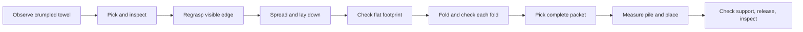

# Towels and other cloth

Use `api.cloth_actions.ClothActions` for composable interactions and
`api.cloth_vision.ClothVision` for the configured Gemini inspection tool. Inspect
a new capture after each motion. Model checks and pixel candidates are not metric
poses. Use calibrated geometry for targets. Keep `unknown` results uncertain.
Use `api.cloth_trial.TrialContext` for task records and `ReplayContext` for strict
offline call replay. Keep a separate live Context available for stop requests.

Use `api.cloth.Cloth` for optional geometric cloth routines. Use `api.evo.Evo.execute` for individual
previewed actions. Both use the registered Evo tools through `api.runtime.Context`.
Evo owns motion and stop checks. RAX owns cloth perception and task checks.



Supply a perception function `perceive(observation, check) -> Scene`. It must read
the current saved images and return that observation's ID. `Scene.from_dict` can
read its JSON result. Use the agent's vision or a task estimator to label state,
visible boundaries, grasp retention, layer capture, support, and alignment. Use
calibrated geometry to supply metric points. The library does not include a
trained cloth detector. Do not return success labels to make a routine continue.
`unknown`, `uncertain`, and `lost` are useful results.

`Grasp.position` is a **palm** target, with an xyzw orientation. Measure the tool
offset to derive it from `Grasp.feature_position`, the cloth contact point. These
are separate points. Give each candidate an ID, feature type (`surface`, `edge`,
`corner`, or `packet`), score, and measured uncertainty. Packet grasps must capture
all folded layers. A closed finger position does not prove this.

Use `api.cloth_geometry.triangulate` with corresponding `evo_camera_ray` results
from synchronized views. It rejects parallel, mismatched, or backward rays. Its
residual is not a metric uncertainty estimate. `on_measured_plane` applies only
to a point verified on that measured surface. Do not project crumpled or suspended
cloth onto the table. Missing calibration is a reason to stop metric manipulation.

A `Scene` contains ordered rectangle corners, per-hand `held` and `layers`
evidence, separate `stable` and `supported` checks, and optional measured surface,
packet bottom, and pile top. `Pile.center.z` is the current top height. Its size
is the available placement region; its yaw defines that region's axes. Stacking
remeasures the packet and pile after pickup. It requires support and alignment
before release. It then retracts and checks the pile again.

Use a task-specific settings file for open/close finger angles and motion lengths.
Do not infer an open direction from the angle sign. Use measured landing palm poses
for lay-down. Keep the base fixed while one `Cloth` instance holds geometry.
Create a new instance and obtain new observations after base motion.

```python
from api.runtime import Context
from api.cloth import Cloth, ClothSettings, Scene, ClothUncertain
from towel_perception import estimate  # Task implementation, not a bundled model.

with Context() as ctx:
    settings = ClothSettings(**task_settings)  # Measured tool and task settings.
    def perceive(observation, check):
        return Scene.from_dict(estimate(observation, check))
    towel = Cloth(ctx, perceive, settings)
    try:
        towel.crumpled_to_pile(landing_poses, span_m, axes=("v", "u"))
        # For a towel that is already folded: towel.stack_folded()
    except ClothUncertain as error:
        save_evidence(error.evidence)
        # Inspect the current cloth and choose a recovery. Do not retry blindly.
```

Available routines are `pinch_and_check`, `lift_and_inspect`, `spread_to_span`,
`align_held_edge`, `anchor_and_pull`, `regrasp`, `lay_down`, `fold_over_line`,
`unfold`, `fold`, `stack_folded`, and `crumpled_to_pile`. `fold` uses ordered corners
to make half-folds along local `u` or `v`. Its material-length path includes the test lift. It checks the measured half-size
footprint, alignment, stability, and support before release and after release.
The zero-thickness planner is optional; learned policies can use small interactions
without it. Desired `check.target` geometry must never be copied into perception
results as measured evidence.
A fold of an already folded towel requires packet grasps and full-layer checks.
Choose fold axes that fit the robot workspace. If the next edge cannot be reached,
change the towel placement and observe it again. The unfold loop has a fixed attempt budget. It stops when a second edge is not
visible or a check is uncertain; change the view or supply another measured grasp.

Spread uses bounded changes in hand distance and image checks. It does not measure
tension. Do not use these routines for force control, tactile sliding, dynamic
flinging, or blind untangling. Evo checks the robot model and configured bounds;
the caller must also check clearance from the table, pile, and other objects.

`evo_set_grip(retain=True)` keeps the position target through normal arm and body
actions. It reports position and stop evidence, not grasp success. Normal completion
can retain a target even if the finger cannot reach it. Cancel, hold, disarm, lease
loss, stale feedback, and faults remove retention and hold measured joints; they do
not command the fingers open. `ClothUncertain` stops the routine before the next
motion and leaves current grips retained while authority remains valid. Use a
separate Context to request `evo_hold` if all motion and retained targets must stop.
