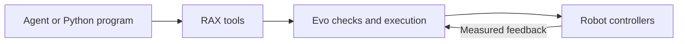

# Evo v3 interface

Evo owns motion, limits, recording, and operator arming checks. Use the registered
`evo_*` tools. Python programs use the same interface through `api.runtime.Context`.
Use `api.evo.Evo` to wait for an action result. Do not use a controller SDK or ROS
publisher from the agent workspace.

Read `evo_capabilities` and `evo_status` first. Check ownership, freshness, recording,
and measured joints. Operator arming is required for motion. The agent cannot arm,
change limits, reset faults, or switch controllers.

Use SI units. Joint names are explicit. Arm, gripper, and neck positions use radians;
carriage position uses metres. `evo_gripper` takes `side` and `position_rad`. It does
not set grip force. Cartesian targets use `frame: "base_link"` or `"carriage_link"`.
Quaternions use `[x, y, z, w]` and must have unit length. Base velocity uses
`[vx, vy, yaw_rate]` in the robot base frame and a bounded `duration_s`.

Use `evo_preview` with an action before motion. Preview checks the prepared path
against robot joint limits, self-collision, and the configured workspace. It does
not check objects in the scene. Execution prepares the path again from fresh state.
Use small steps near objects and inspect a new observation after each action.

Action tools return an `action_id`. Poll `evo_action_status` until `succeeded`,
`cancelled`, or `failed`. `accepted` and `running` do not establish completion.
`evo_cancel` takes the action ID. `evo_hold` requests a stop. A stop request is not
proof of a stop: inspect `physical_stop_verified` in the terminal result. Cancel,
hold, and status use a separate frontend path. In Python, use another `Context`
connection to request a stop while an observation or model call is pending. A lost
connection stops the client lease. Never retry an action with an uncertain result.

`evo_observe` saves RGB images and metadata. Inspect each camera error and capture
time. A partial result is not a complete camera bundle. Metric rays require valid
calibration and capture-time state. `evo_camera_ray` takes the `observation_id`,
`camera`, and `pixel` from that capture. A ray has no depth. Missing calibration
must not be replaced with an assumed camera pose. Use `evo_history` for recent
measured state and the recording path.

Depth, force control, scene collision checks, and navigation are unavailable.
Simulation checks software behavior. They do not establish physical stopping
performance or task success.
