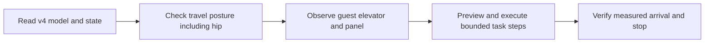

# Evo v4 elevator navigation

Read `evo_capabilities` and `evo_status`. Use the `evo-v4` profile and the loaded
v4 model. Its travel posture must include `hip_pitch_joint`, both arms and the
carriage. Check measured arrival and stop before moving the base. Never use a
v3 carriage target or assume a hip position from the last command.

Use `api.elevator.Elevator` with operator-supplied model and tool calibration.
Use `api.elevator_sim.SimulationElevator` only for an explicit simulator context.
Keep simulator geometry observations separate from camera perception. A fixture
pass cannot establish a physical button press or hotel navigation.

The target property is Hilton University of Houston. Supplied historic maps
identify a guest elevator beside the north-wing hotel lobby and distinguish it
from garage elevators. Confirm the current bank and panel from fresh site
observations. The maps have no metric scale; do not derive button heights,
door widths, cabin dimensions or sill gaps from their drawings.

Use `press_elevator_button`, `navigate_into_elevator`, and
`navigate_out_of_elevator` only when their observations and previews are valid.
These routines do not establish floor selection or destination-floor identity.

## Offline execution

Run stored Python task code with prepared local models and calibration. Do not
request cloud inference or download files during the task. The local Evo
interface remains the motion owner. Missing assets or observations must cause a
clear failure; do not use an online substitute.
