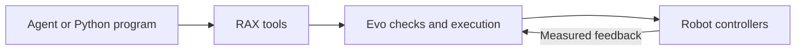

# Evo v4 interface

Evo owns motion, limits, recording, and operator arming checks. Use the registered
`evo_*` tools. Python programs use the same interface through `api.runtime.Context`.
Use `api.evo.Evo` to wait for an action result. Do not use a controller SDK or ROS
publisher from the agent workspace.

Read `evo_capabilities` and `evo_status` first. Check ownership, freshness, recording,
and measured joints. Operator arming is required for motion. The agent cannot arm,
change limits, reset faults, or switch controllers.

Use SI units. Joint names are explicit. Arm, gripper, and neck positions use radians;
carriage position uses metres. `evo_gripper` takes `side` and `position_rad`. It does
not set grip force. Cartesian targets use `frame: "base_link"` or `"carriage_link"`.
Quaternions use `[x, y, z, w]` and must have unit length. Base velocity uses
`[vx, vy, yaw_rate]` in the robot base frame and a bounded `duration_s`.

Use `evo_preview` with an action before motion. Preview checks the prepared path
against robot joint limits, self-collision, and the configured workspace. It does
not check objects along arm paths. Configured measured base actions also check
point-cloud obstacles and floor support over the swept travel envelope. Execution prepares the path again from fresh state.
Use small steps near objects and inspect a new observation after each action.

Action tools return an `action_id`. Poll `evo_action_status` until `succeeded`,
`cancelled`, or `failed`. `accepted` and `running` do not establish completion.
`evo_cancel` takes the action ID. `evo_hold` requests a stop. A stop request is not
proof of a stop: inspect `physical_stop_verified` in the terminal result. Cancel,
hold, and status use a separate frontend path. In Python, use another `Context`
connection to request a stop while an observation or model call is pending. A lost
connection stops the client lease. Never retry an action with an uncertain result.

`evo_observe` saves RGB images and metadata. Inspect each camera error and capture
time. A partial result is not a complete camera bundle. Metric rays require valid
calibration and capture-time state. `evo_camera_ray` takes the `observation_id`,
`camera`, and `pixel` from that capture. An ordinary RGB ray has no depth. Missing calibration
must not be replaced with an assumed camera pose. Use `evo_history` for recent
measured state and the recording path.

Force control, arm-to-scene collision checks, and general navigation remain unavailable.
Use `scene.configured` in capabilities to check local point-cloud base control.
Simulation checks software behavior. They do not establish physical stopping
performance or task success.

## Paths and retained grips

Use `evo_follow_path` for straight Cartesian segments with smooth progress and
shortest quaternion rotation. Each waypoint gives a duration and the same selected
components: either or both palms, carriage, and/or neck. Each segment stops before
the next one. Use `evo_move_pair` for midpoint and separation targets; separation
points from the right palm to the left palm. Both hands share the same timing.
Pair motion interpolates span separately from direction, so rotation does not
shorten a constant span. Opposite directions need an intermediate waypoint.
`evo_move_body` coordinates named arm, carriage, and neck joint targets. Increase
duration if a path exceeds velocity or acceleration limits. `evo_move_eef` solves
an endpoint and follows a joint-space path; its palm path is not straight.

`evo_set_grip` accepts `side`, `position_rad`, and `retain`. Retention keeps that
position command through normal actions and while idle with valid authority.
Completion does not prove cloth contact or capture of all layers. Stop requests,
disarm, faults, and lease loss clear retention and hold measured joints. They do
not open the fingers. The fixed-finger v4 simulation cannot validate grasping. Check the loaded model before using any gripper action.

## Elevator primitives

Use `api.base.Base` for `rotate_base`, `translate_base`, and angle, distance, or
lateral alignment. `rax_move_base` takes `delta: [dx_m, dy_m, yaw_rad]`. Separate
rotation from translation. Completion requires measured lidar pose and a verified
stop. Both arms, the carriage and hip_pitch_joint must be in the configured travel posture.

Use `api.elevator.Elevator` with operator-supplied `ElevatorSettings` and
`ArmProfile` values. Profiles must contain measured elbow-bent wrist-view poses,
a pressing-tip transform, a press orientation, and exact label-to-press offsets.
Do not invent these values from an image. `press_elevator_button` turns toward the
panel, obtains fresh wrist captures, selects a feasible arm, aligns the carriage,
approaches in bounded steps, presses, and retracts. Each arm candidate must pass
approach, press, and retract previews. `rax_detect_buttons` preserves the detector's
exact image and capture state. For these captures, `rax_camera_ray` also requires
local point-cloud support at the requested press pixel.

`stroke_complete_unconfirmed` means the arm completed its stroke. The current
detector cannot prove button activation. Do not repeat an uncertain press.
After an interrupted approach or press, inspect the action result and measured
state before an explicit `retract_arm`; do not move the base or stow first.

`navigate_into_elevator` and `navigate_out_of_elevator` require a measured goal
depth beyond the sill. They stow, wait for a stable open doorway, center, and cross.
The runtime checks the same doorway during motion and measures clearance of the
complete travel envelope. Closed, closing, stale, blocked, or unknown geometry
stops the action. These are local doorway primitives; they do not select a floor,
identify a destination floor, or provide building navigation.

Elevator primitives use the installed local button detector models. Prepare models
and inference engines before the trial. No primitive uses a cloud fallback. Run
a stored Python task when internet is unavailable; no LLM is required. RAX supplies
Python task logic and wrappers. Evo owns scene processing, base planning, actuator
commands, and measured stops. Enable its optional `evo_agent_backend.elevator`
configuration before use; check `scene.configured` in capabilities.

## SAM perception

Read `evo_capabilities.sam` first. SAM runs in Evo and requires an operator-enabled
service. Call `evo_sam_segment` with an observation ID and camera. Text defaults to
`towel`; a pixel box can limit a prompt. `evo_sam_track` takes ordered captures
from one camera and text or labelled points on the first frame. IDs are local to
one clip. A point prompt defines one object; `1` is positive and `0` is negative.

Use a visible distinguishing property in a text prompt when selecting a towel,
for example `prompt="red towel"`. Inspect the first mask and later overlays.
A generic prompt can delay track creation or include other towels. If the intended
object is not selected, use labelled points on a reviewed first frame. Keep the
choice of object in RAX; the Evo profile owns detection and track thresholds.
When an object is hidden, keep empty results. A returned ID after occlusion is
model evidence, not proof of physical identity or grasp retention.

Poll `evo_sam_result` for state, then fetch each `frame_index`. Mask and overlay
paths are under `runtime/sam`. Use `api.sam.Sam(ctx)` for submit, wait, retrieval,
and cancel through the same tools. Call `evo_sam_cancel` to discard a job. The GPU
worker can remain busy until that inference ends. Robot `evo_cancel` and `evo_hold`
remain separate and must be used to stop motion.

Default coordinates are captured pixels. Rectified mode requires capture-bound
calibration and returns its mapping. Do not pass rectified pixels directly to
`evo_camera_ray`, which takes captured pixels. A mask is not metric position,
verified grasp retention, full layer capture, or task success. Inspect candidate
scores and overlays; the highest score can select a different towel. Keep empty
and ambiguous results. Use `api.cloth_trial.TrialContext` to save input captures,
model outputs, and task evidence for replay.

## V4 model identity

Select `evo-v4`. The backend refuses a model without `hip_pitch_joint`. Read
carriage and hip limits from `evo_capabilities`; do not copy v3 targets. The
pinned v4 simulation has fixed fingers, a shorter carriage, and a fixed
intermediate lift stage. Its drive settings are simulation assumptions.
Read [elevator-navigation](../elevator-navigation/SKILL.md) before an elevator task.
