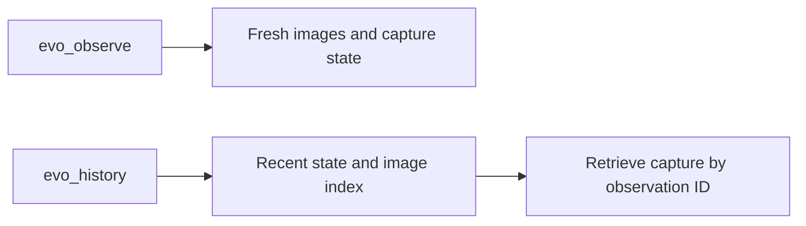

# Evo observations and recent history

Call `evo_observe {}` before motion after a pause. It returns fresh RGB images,
capture timestamps, calibration validity, and associated measured state. Inspect
camera errors. Images are saved under `runtime/frames/` in the agent workspace.

Call `evo_history {}` to read `states`, `observations`, and `recording`. The index
contains capture metadata. Call `evo_history {"observation_id": "..."}` with an
indexed ID to retrieve its saved RGB images and original capture-time state.
The backend captures history independently of agent calls. Images are bounded
by count and encoded byte size; an evicted ID is refused.
The recording value is an operator-owned bag path, not an agent-readable image
folder. History is bounded by sample counts, not a fixed time interval. Read the
timestamps to find its actual coverage.



Python programs use the same tools:

```python
from api.runtime import Context

with Context() as ctx:
    observation = ctx.value("evo_observe")
    history = ctx.value("evo_history")
    previous = ctx.value("evo_history", observation_id=observation["observation_id"])
```

Use saved observation IDs with `evo_camera_ray` only when camera geometry is valid.
Rays do not supply depth. Save the images and results needed for task evidence in
the workspace. Request a new observation to check scene changes; state history
alone cannot show a moved object.
