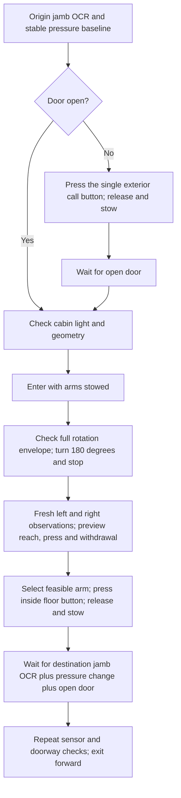

# Interior elevator ride

`api.elevator_cabin.CabinRide` is a separate, opt-in controller. It composes an
`Elevator` or `SimulationElevator` instance. Existing outside-panel and reverse-exit
routines keep their behavior. The cabin task requires both arm profiles.



Example construction:

```python
from api.elevator_cabin import CabinRide, CabinRideSettings

ride = CabinRide(
    interior_task,
    CabinRideSettings(
        origin_floor="1",
        floor_heights_m={"1": 0.0, "2": 3.6},
        entry_depth_m=1.0,
        exit_depth_m=0.6,
    ),
    hall_task=single_call_button_task,
)
result = ride.run("2", doorway_id="guest-elevator", on_stage=save_stage)
```

These dimensions are example configuration, not surveyed hotel measurements.
The scene provider must supply the actual test cabin polygon and full travel
footprint. An entry depth does not prove turn clearance. The controller checks
clearance after entry and refuses a turn that does not fit. It does not widen the
cabin or reduce the robot envelope.

The hall task must have a different panel identity and exactly one calibrated
control, `CALL` by default. It runs only when the origin door is not stably open.
It must confirm activation, release and stow before the ride can continue. There
is no repeated press after an uncertain result. If the two tasks share a context,
the adapter must route each task to its own panel observations. A context facade
can do this while retaining the same motion owner.

The controller uses a circle with radius `hypot(half_length, half_width)` for the
turn sweep. It adds the existing clearance margin, measured geometry uncertainty
and existing position tolerance. This circle contains every yaw of the complete
source travel footprint. Ceiling clearance uses the full configured robot height.
The existing per-command turn bound can split the turnaround into stopped
commands. Each command retains native preview, endpoint and measured-stop gates.

The interior press does not turn or translate the base. Both wrist views are
fresh after the viewing moves. Each arm must pass the existing approach, press
and withdrawal preview. Selection uses tip travel, joint-limit margin and image
error. A refused arm is excluded. If both arms are refused, the controller stops.
The selected button is observed again before approach and contact. Source speed,
effort, position, Cartesian completion, contact and stop limits are unchanged.
A separate adapter must provide the actual panel detector; a simulated button
observation is still privileged geometry, not a test of OCR.

The entry RGB receipt establishes that the cabin image is lit. The lighting
source records an authored simulation or camera observation. An authored lux
target does not establish measured illuminance or physical photometry.

| Sensor or decision setting | Default |
|---|---:|
| Floor sensor maximum age | 3.0 s |
| Floor sensor/scene maximum skew | 0.1 s |
| Minimum OCR confidence | 0.8 |
| Minimum normalized cabin image mean luma | 0.05 |
| Maximum cabin geometry uncertainty | 0.02 m |
| Maximum pressure uncertainty | 2 Pa |
| Maximum stable pressure span | 2 Pa |
| Minimum stable pressure sample count | 3 |
| Height error band, including pressure uncertainty | 0.75 m |
| Assumed air temperature for pressure conversion | 293.15 K |
| Arrival timeout | 90 s |

Floor height bands must not overlap. The pressure calculation uses the raw
origin/current pressure ratio and the configured air temperature:

`height_change = (287.05 * temperature_K / 9.80665) * log(origin_Pa / current_Pa)`

Both bounds of the pressure uncertainty interval must fit the destination height
band. Correct OCR with unchanged or excessive pressure change is refused. Correct
pressure change with another floor label is refused. The controller waits without
moving at another floor and stops at timeout. Invalid, stale, uncalibrated or
ambiguous sensor evidence stops the sequence. The origin pressure receipt remains
in the result. The temperature assumption and pressure drift limit require a
separate hardware sensor assessment.

The floor observation tool contract is:

```python
context.value("rax_floor_observation", doorway_id="guest-elevator")
# {
#   "observation_id": str, "capture_us": int,
#   "ocr": {
#     "source": "image_ocr", "text": str, "text_readable": True,
#     "confidence": float, "capture_us": int, "image_sha256": str,
#     "doorway_id": str, "location": "landing_door_jamb",
#   },
#   "barometer": {
#     "source": "barometer" or "simulated_barometer",
#     "pressure_pa": float, "uncertainty_pa": float, "capture_us": int,
#     "stable": True, "sample_count": int, "span_pa": float,
#   },
#   "scene": same_capture_scene,
# }
```

OCR must read an image of the landing label. A floor ID from the simulator cannot
replace it. The image hash, observation identity and pressure evidence are saved.
An optional synchronized `scene` carries the doorway state at image capture; if
omitted, a fresh scene must meet the same skew bound. The robot is stationary
during the floor capture. The floor-sensor age allowance does not change the
existing motion observation limits.

`rax_scene.cabin` contains `id`, `doorway_id`, `panel_id`, convex `polygon_m` in
current base-link XY coordinates, `ceiling_height_m`, `geometry_uncertainty_m`,
and `lighting`. Lighting contains `enabled`, `source`, `capture_us`,
`image_sha256`, and normalized `mean_luma`. `scene.panel` must identify its `id`,
`cabin_id`, and `location: inside_cabin`, with its existing point and normal.
The panel point must be inside the cabin polygon.

`on_stage` receives a dictionary with `stage`, `event`, and optional `result` or
`reason`. Stage names are `origin`, optional `hall_call`, `entry`, `turn`, `button`,
`destination`, and `exit`. Events are `started`, `finished`, or `failed`. Results
retain the turn observations, arm candidates, sensor evidence and action checks.
Callbacks can record simulation timestamps. The full ride and button stage have
separate boundaries; the controller does not reset a simulator clock or assert a
hardware timing result. A used controller cannot repeat a press or resume an
uncertain ride.

CPU checks cover mirrored arm selection, turn clearance, missing measured stops,
refused motion previews, inside-panel identity, a separate hall call, stale or
wrong OCR, pressure mismatch/drift, and a door that closes after verification.
They do not qualify physical contact, OCR accuracy or elevator hardware.

```sh
uv run --with pytest --with jinja2 --with numpy --with pillow python -m pytest -q \
  local_tests/unit/test_elevator_cabin.py local_tests/unit/test_elevator.py \
  local_tests/unit/test_elevator_sim.py local_tests/unit/test_elevator_runtime.py \
  local_tests/unit/test_evo_motion.py
```
