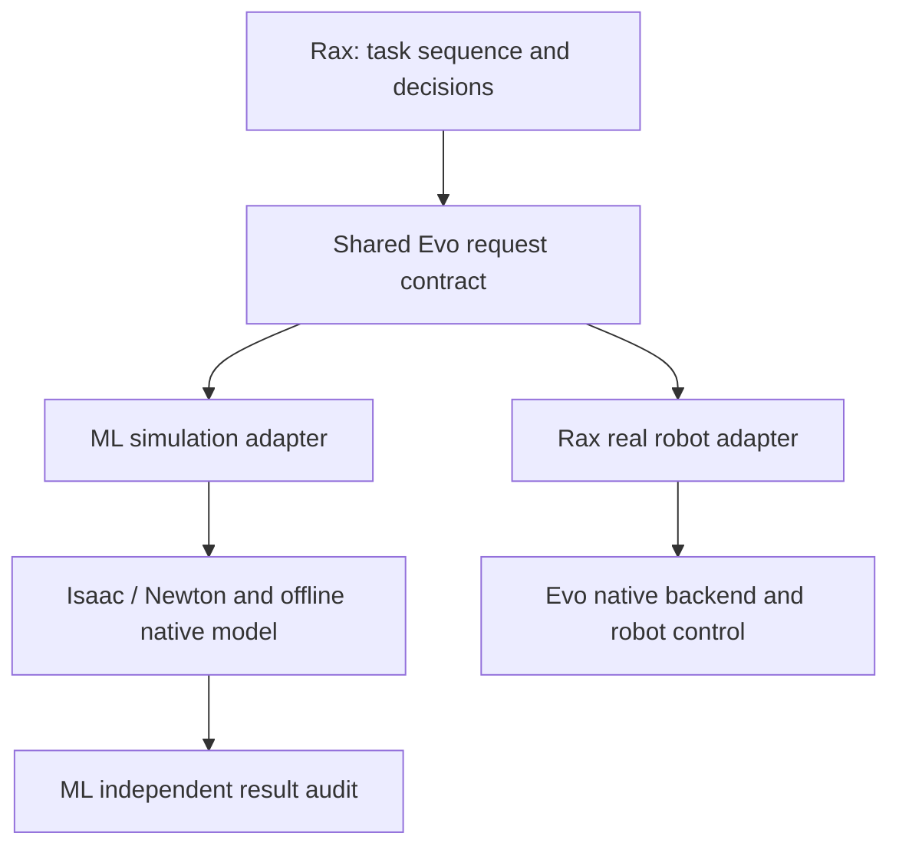

# Elevator behavior and adapter boundary

This is the ownership contract for the V4 elevator task. A simulation result
qualifies only the recorded adapter, configuration and test scope.

| Owner | Required responsibility |
|---|---|
| Rax task | Press, release, stow, wait, enter, select floor and exit; observation freshness; deadlines, retry, abort and recovery decisions |
| Shared Rax contract | Tool names, argument schemas and common acceptance/terminal response checks |
| Rax real adapter | Transport to Evo, feedback, action lifecycle and physical stop evidence |
| Evo native stack | Production trajectory planning, configured limits, control, leases and watchdog |
| ML simulation adapter | Translate the same supported requests into simulated execution; return measured state and explicit simulation-only evidence |
| ML environment | Geometry, materials, lights, door timing, button mechanics and sensor rendering |
| ML qualification tools | Frozen inputs, test starts, independent clearance/timing/stop audits, replay and videos |

The ML runner selects fixtures and calls the Rax task. It must not advance the
task, select a successful perception target from scene truth, or override a
Rax refusal. An independent ML audit can reject a Rax success. It cannot turn
a Rax failure into success. Capture-only and reach-only fixtures are not
operational elevator behavior.

`services/evo/contracts.py` supplies the request validator used by the real
backend and ML. `tools.json` is the checked-in native Evo tool contract;
`elevator_tools.json` contains Rax extensions. ML freezes and hashes all three.
Supported tools must be advertised explicitly. Unsupported tools must refuse.
A failed replacement preview revokes the earlier approval. A motion requires
an identical valid preview. Terminal results require physical-stop evidence;
a boolean field alone does not prove that the robot stopped.

`api.elevator_sim.ImageSimulationElevator` owns simulation activation decisions
in Rax. It requires an image observation and an explicit, matching simulator
activation/release event. This is a simulation test adapter, not a hardware
button-activation implementation. Simulator truth must remain labelled.

## Current compatibility and limits

| Interface aspect | Current ML status | Remaining work before hardware equivalence |
|---|---|---|
| Requests | Same validator and pinned schemas as Rax real backend | Check schema against each deployed Evo build |
| Acceptance and terminal fields | Shared shape checks; measured stop checks remain in the driver/audit | Qualify full response and error behavior |
| Action lifecycle | Blocking execution; accepted response follows execution | Exercise asynchronous states and concurrent status |
| Cancellation, lease, watchdog | Not implemented in the ML adapter | Qualify cancel, expiry, transport loss and safe stop with the native backend |
| Planner | Offline native IK/FK and base replay, plus ML interpolation | Run or qualify the production Evo trajectory planner and its exact policy |
| Limits | Source caps and explicit simulation drive policy | Match deployed velocity, acceleration and control configuration |
| Time | Simulation clock; held-physics rendering/inference is excluded | Measure complete hardware wall time, including sensing and transport |
| Observations | Simulated sensors; some fixtures use labelled scene truth | Qualify real sensor, door and activation adapters and freshness |

ML capabilities and reports include `adapter_contract.hardware_parity=false`.
Do not use a simulation pass as hardware admission. In particular, source
joint speed compliance does not prove compliance with the native demo policy.
The current native capability robot label is not sufficient model identity:
Rax V4 also checks the loaded model and hip/carriage limits.

The full button deadline includes preparation, press, release and stow.
The current Rax deadline check runs at stage completion. It prevents the next
stage after a late result; it is not an in-flight cancellation guarantee.
Report simulation duration and wall duration separately.

## Required checks before a real trial

1. Pin the Evo build, robot model, tool, calibration and production limits.
2. Run common request/response cases through both adapters. Include malformed
   input, stale observations, unknown actions, refused previews and failed stops.
3. Test cancellation, watchdog expiry and transport loss with the native
   backend. Verify actual stops before enabling contact or doorway crossing.
4. Validate perception and metric contact on a guarded test panel, then validate
   press/release/stow timing. Do not use a hidden simulator target.
5. Validate door observations, sill crossing and outside clearance in a
   controlled physical setup before a hotel trial.

Keep original bounds and failed evidence. Add a separate qualification record
for each completed requirement; do not infer hardware readiness from a video.

`Elevator.press_and_enter()` is the Rax hall prefix. It calls the existing full
button sequence, requires confirmed activation/release/stow and a duration
strictly below the selected deadline (at most 20 seconds), then calls the
existing fresh-door entry routine. Failure prevents entry. It validates that
the entry goal clears the full robot before pressing. This remains a stage-end
deadline check, not an in-flight cancellation guarantee.

`ElevatorSettings.retract_segment_s` can select a separate withdrawal duration.
Its default is `None`, which retains `segment_s`. This does not change clearance,
stroke, dwell, source limits, preview checks or required measured stops.

The opt-in `tangent_approach_correction` policy belongs to Rax. During an
unpressed approach it can correct a fresh image's tangential offset with an
arm-only Cartesian path. It keeps the measured normal gap and carriage, retains
the original orientation-sweep check, and limits correction distance to the
existing approach step and remaining travel budget. It cannot follow a press
attempt, change labels, or remove the recovery reference after a failed path.
The default remains disabled until a robot/profile is qualified.
