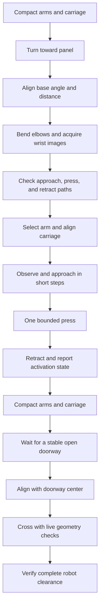

# Elevator primitives

The Python API composes measured actions through the Evo motion owner. It adds
base alignment, wrist viewing, arm selection, carriage alignment, button pressing,
and local elevator entry and exit. The paired Evo change supplies point-cloud
geometry, lidar pose feedback, detector capture storage, and guarded base actions.

The implementation is opt-in. A deployed profile must supply measured sensor,
robot-envelope, arm-view, and pressing-tip calibration. The default Evo agent
profile keeps these capabilities disabled. The code has not been qualified for
physical elevator operation.



## Interfaces

Import `Base` from `api.base` and `Elevator`, `ElevatorSettings`, and `ArmProfile`
from `api.elevator` inside an agent workspace. Repository tests use the
`auto_research_agent.api` namespace. The existing workspace builder copies these
modules to the agent workspace.

| API | Result or purpose |
|---|---|
| `Base.rotate_base(angle_rad)` | Relative measured yaw; positive is counterclockwise |
| `Base.translate_base(dx_m, dy_m)` | Relative base-frame displacement; swerve supports lateral travel |
| `Base.align_base_angle(angle_rad=0)` | Align heading with a measured vertical surface normal |
| `Base.align_base_distance(standoff_m)` | Set the normal distance to that surface |
| `Base.align_base_lateral(offset_m=0)` | Set offset along that surface |
| `Elevator.orient_base_to_panel(panel_hint=None)` | Stow, turn to an optional bearing, then find and align with a panel |
| `prepare_button_view(arms=None)` | Reach and verify configured joint poses with bent elbows |
| `search_button(label, arm="auto")` | Search configured wrist poses and bounded base turns |
| `observe_button(label, side)` | Locate an exact label using a captured wrist image and local depth support |
| `select_press_arm(observations, preference="auto")` | Preview approach, press, and retract for each arm; report the selection or `reposition_required` |
| `prepare_press_arm(selection)` | Acquire a new image and set the pressing orientation with clearance |
| `align_carriage_height(label, side)` | Adjust measured tip height; observe after each change |
| `align_arm_to_button(label, side)` | Align the pressing tip while maintaining distance from the panel |
| `approach_button(label, side)` | Make bounded inward steps; observe between steps |
| `press_button(label, side)` | Make one configured stroke and dwell |
| `retract_arm(side)` | Withdraw along the last verified panel normal |
| `verify_button_activation(label, side)` | Report `unknown` with the current label-only detector |
| `press_elevator_button(label, arm="auto", panel_bearing_rad=None)` | Run the complete press sequence |
| `observe_doorway()` / `wait_for_door_open(...)` | Read geometry or wait without moving the base |
| `align_to_doorway(..., staging_gap_m=...)` | Stow, wait, and align before the sill |
| `navigate_into_elevator(..., goal_depth_m=...)` | Enter and verify that the full travel envelope has crossed |
| `navigate_out_of_elevator(..., goal_depth_m=...)` | Exit through the same doorway, with direction set from the current side |

Methods take distances in metres and angles in radians. They do not arm the robot.
`PrimitiveResult` retains evidence and measured outcomes. A refusal, cancellation,
or failed physical stop raises an exception and prevents the next stage. An
interrupted inward movement retains the last approach reference. Stowing or moving
the carriage is refused until an explicit retraction has completed.

The travel methods perform local doorway traversal. They do not identify an
arrival floor or navigate through a building. The legacy `evo_elevator` manual
advance publisher remains a demonstration; it is not used as proof of completion.
The Python compositions advance only after successful action results.

## Runtime contract

| Tool | Contract |
|---|---|
| `evo_scene` | Fresh scene ID, source time, base pose, panel plane, doorway ID, aperture width, and opening state |
| `evo_move_base` | `delta: [dx_m, dy_m, yaw_rad]`, optional `doorway_id`; separate rotation from translation |
| `evo_detect_buttons` | `camera` and `score_threshold`; returns exact source JPEG, detections, capture-time joints, calibration, and synchronized scene |
| `evo_camera_ray` | Uses the saved capture. For detector observations, also requires local panel depth support and rejects a nearer surface |

`evo_move_base` uses the same ownership, arming, lease, recording, cancellation,
and measured-stop checks as existing actions. It holds the complete configured
travel posture. It checks cumulative distance, angle, drift, timeout, progress,
obstacles, floor support, and doorway state. Results include residual error and
`before`, `straddling`, or `after` for the full robot envelope.

Heading uses a fixed lidar reference. The implementation follows the partial-turn
approach and failure checks in [Evo #1102](https://github.com/Kovari-Industries/evo/pull/1102).
It fits points to local wall surfaces. Wall normals must constrain both planar
translation directions; parallel walls alone are refused. The fit also requires
overlap, convergence, a bounded residual, and fresh timestamps. It does not substitute wheel yaw after a rejected fit.
Loss of the reference requires a runtime restart. The separate full-revolution
closure experiment in that PR is not implemented here.

Point-cloud processing runs in a blocking worker outside the action supervisor.
It checks `PointCloud2` layouts, finite returns, source frames, capture times, and
capture-time model transforms. Sources can publish at different rates. The worker
waits for a pair within the synchronization limit, and the last complete scene
remains subject to the age limit. It prepares floor and obstacle cells before the
supervisor checks a path. The doorway tracker requires jamb support at different
heights, returns beyond the aperture, enough width, and stable repeated captures.
Loss of evidence resets open confirmation. A shrinking aperture is `closing`.
Missing evidence is unavailable or `unknown`; it does not authorize motion.

The swept-envelope check uses sampled obstacle cells and measured floor support.
It is not a general scene-collision model for arms or a certified free-space map.
Reflective surfaces, incomplete coverage, motion distortion, calibration error,
and sensor blind areas need qualification on the actual robot. The configured
margin must include measured sensor and motion error. The travel envelope must
include both arms, hands, carriage, attachments, and any carried load.

The exact detector image is stored through the existing RAX observation path.
A label box is not assumed to be the physical button boundary. `press_offsets`
selects the measured press point relative to the label-box center, in box widths
and heights. Both a plane intersection and local depth returns must support that
point. All arm paths retain the existing joint, velocity, self-collision, and
workspace checks. They do not provide force control or collision checks against
all objects in the scene.

## Configuration

The existing exclusive agent profile owns the actuators. Add `scene` and
`button_service` under `evo_agent_backend` in its operator configuration. Neither
field is available as an agent setting. `null` disables each feature.

Use `/button_recognition/detect` for the existing detector when that service is
running. The current sensor configurations use `/unilidar/cloud`; select and
verify the actual Orbbec point-cloud topic on the installed sensor revision.
Do not infer an optical transform from a topic name.

| Scene setting | Required measurement or constraint |
|---|---|
| `sources` | One or two `PointCloud2` sources; exactly one supplies lidar heading |
| Source fields | `topic`, exact `frame`, `parent_link`, `translation`, unit `quaternion_xyzw`, `provenance`, `heading` |
| `footprint` | Half length, half width, and top height of the complete compact robot envelope |
| `travel_joints` | Measured compact targets for both complete arms and the carriage; optional additional joints |
| `margin_m` | Qualified clearance, including sensing, calibration, interpolation, and stopping errors |
| `floor_z_m`, `floor_tolerance_m`, `floor_grid_m` | Measured floor reference, allowable sill/height error, and support sampling interval |
| `minimum_door_width_m`, `maximum_door_width_m` | Admissible aperture search range |
| `max_age_s`, `max_skew_s` | Sensor age and synchronization limits |
| `max_step_m`, `max_turn_rad`, `max_drift_m` | Per-action motion and drift limits |
| `linear_speed_mps`, `angular_speed_radps` | Qualified speeds, within the existing backend limits |
| `acceleration_mps2`, `angular_acceleration_radps2` | Qualified acceleration and braking bounds |
| `position_tolerance_m`, `angle_tolerance_rad`, `no_progress_s` | Arrival and progress limits |

| Software ceiling | Value |
|---|---:|
| Cloud age | 0.5 s |
| Source skew | 0.05 s |
| Cloud/joint association | 0.02 s |
| Floor sampling interval | 0.025–0.1 m |
| Floor height tolerance | 0.03 m |
| Translation per action | 2 m |
| Rotation per action | π rad |
| Linear speed | 0.15 m/s |
| Angular speed | 0.15 rad/s |
| Base action timeout | 90 s |
| Press depth beyond measured surface | 0.03 m |
| Press dwell | 2 s |

These are software bounds, not qualified operating values. Supply stricter values
from the robot's calibration and stopping trials.

Each `ArmProfile` specifies the side, all viewing joints, optional search joint
poses, the elbow joint and minimum bend, press quaternion, pressing-tip offset in
the palm frame, lateral base offset, and calibration identity. Configure only arms
with verified profiles. `ElevatorSettings` supplies the panel identity, exact label
offsets, viewing carriage position, panel distance, approach budget, gaps, stroke,
dwell, tolerances, and optional search turns.

A task can load a measured profile as follows:

```python
import json
from pathlib import Path
from api.runtime import Context
from api.elevator import ArmProfile, ElevatorSettings, Elevator

profile = json.loads(Path("memory/elevator-profile.json").read_text())
profile["arms"] = tuple(ArmProfile(**arm) for arm in profile["arms"])
settings = ElevatorSettings(**profile)

with Context() as context:
    elevator = Elevator(context, settings)
    result = elevator.press_elevator_button("2", arm="auto")
    print(result.outcome)  # stroke_complete_unconfirmed
```

A returned stroke does not prove activation. The current detector has no light
state or elevator acknowledgement. Do not automatically repeat an uncertain press.
A doorway must independently pass the open gate before entry or exit.

## Verification and remaining qualification

`local_tests/unit/test_elevator.py` supplies a deterministic fake robot. It checks
the complete press sequence and entry/exit, including the real RAX frontend,
schema validation, Unix transport, and observation storage. It also checks stale
captures, missing calibration/depth, arm reach rejection, target loss, interrupted
approaches, cancellation, late door closure, and unconfirmed activation.

The paired Rust tests cover sensor decoding, lidar geometry, door tracking,
obstacle/floor/sill rejection, control convergence, stop verification, and scene
loss. Run them in the repository's Nix environment:

```bash
KB_EXECUTION=local ./kb test packages/evo_agent_backend packages/evo_orchestrator
KB_EXECUTION=local ./kb generate --check packages/evo_agent_backend
```

Validation on jetson-104 used the local Nix/Bazel environment for Rust:

| Check | Result |
|---|---:|
| RAX elevator and related regression tests | 116 passed |
| Evo agent backend tests | 53 passed |
| Orchestrator unit, CLI, process, and observation tests | 207 passed |
| Existing hardware smoke tests | 3 ignored |
| Shared RAX/Evo tool schema | Exact match |
| Generated Bazel files | Check passed |

The first orchestrator process-test run failed its existing runtime-directory
permission check. Bazel had created a test directory with broader permissions.
The successful run used `--run_under=/tmp/elevator-test-private-dir.sh`. That test
wrapper applies `chmod 700` only to Bazel's `TEST_TMPDIR`, then executes the test.
It does not change production runtime paths or relax the runtime permission check.

The Python fake does not replace a sensor-fed runtime test.
Physical calibration, a complete isolated runtime replay with moving doors, the
legacy elevator state publisher integration, and supervised physical trials remain
separate qualification work. No physical robot runtime was started for this implementation.
