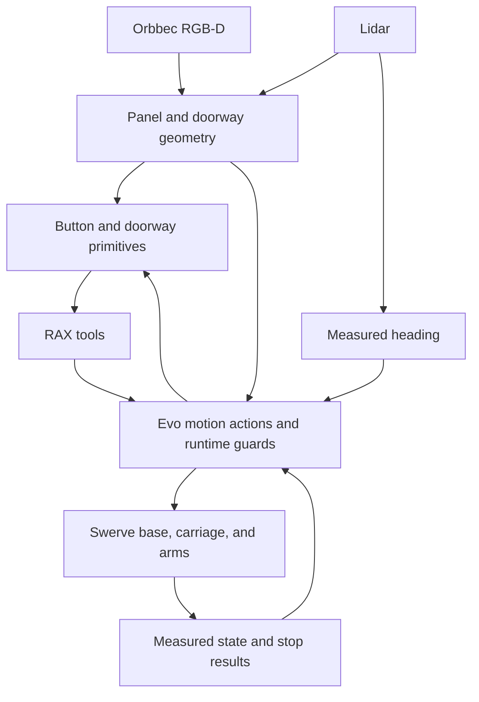
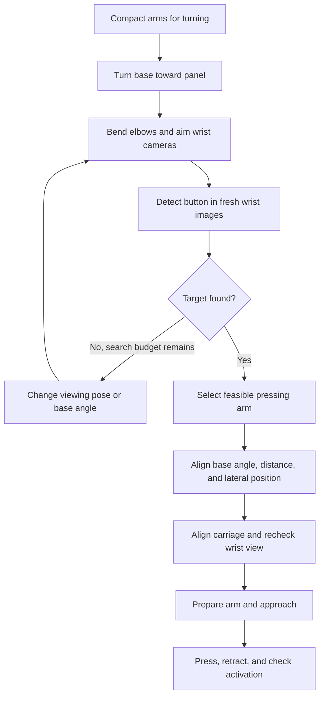
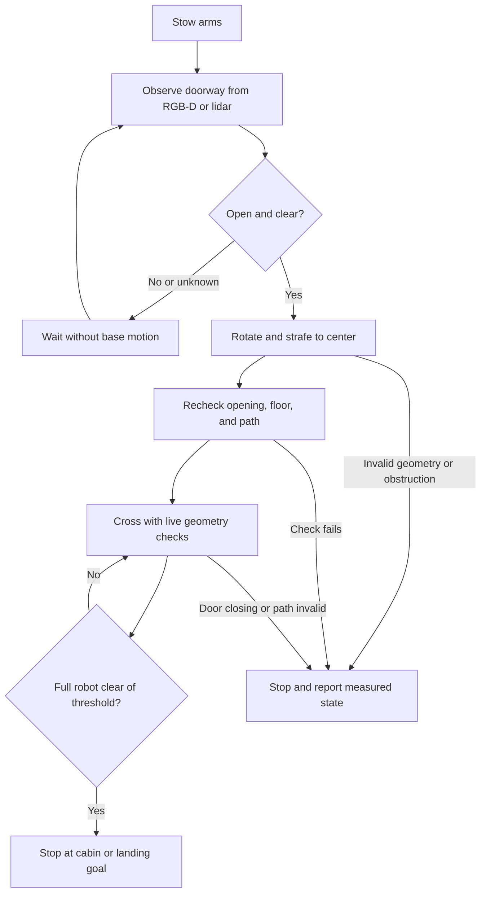

> Architecture update: Evo owns all Rust perception and base planning code, built

This is the original design record. Its RGB-D sensor assumption was superseded:
the robots have RGB cameras. Use the [current primitive guide](ELEVATOR_PRIMITIVES.md)
and [robot test plan](ELEVATOR_ROBOT_TEST_PLAN.md) for sensor requirements and trial
limits. The current press primitive needs local metric point-cloud support.
> into its existing agent backend. RAX contains Python calls, wrappers, and task
> sequences. See [ELEVATOR_PRIMITIVES.md](ELEVATOR_PRIMITIVES.md) for the current
> interfaces, configuration, and offline requirements. The proposal below records
> the original design.

# Elevator motion primitives: proposal and implementation plan

Status: primitive layer implemented and tested with synthetic inputs. Physical
operation is not qualified. [Elevator primitives](ELEVATOR_PRIMITIVES.md) gives the
implemented API, configuration, test results, and remaining work. The
[robot test plan](ELEVATOR_ROBOT_TEST_PLAN.md) defines the physical trial sequence
and task-scale command sizes.

This document retains the proposal and its source baseline. The scope covers
wrist-camera viewing poses, button pressing, arm selection, and local entry into
and exit from an elevator. Phase F includes work beyond this primitive layer.

Use the swerve drivetrain for controlled rotation, forward motion, and lateral
motion. Use the Orbbec RGB-D camera and/or lidar to measure panel and doorway
geometry. Confirm that the doorway is open before navigation starts. Continue
to check the opening and the path during motion.

## Proposal source baseline

| Item | Baseline |
|---|---|
| RAX worktree | `/home/benson/.codex/worktrees/elevator-primitives/rax` |
| Branch | `benson/elevator-primitives` |
| RAX base commit | `6d08fa6` from `benson/evo-v3-backend-client` |
| Local Evo source commit | `c9af8ed814b8f81f6349762ad31d8b0e343787d5` |
| Controlled-rotation reference | [Evo PR #1102](https://github.com/Kovari-Industries/evo/pull/1102), open when inspected |
| PR source commit inspected | `9bf2d1016888d7a6330e8693a6e207e6250b723a` |

At proposal time, both original checkouts contained uncommitted changes. Those
changes were inspected as pending work and were not copied into the new worktree.
The implementation now uses committed RAX base `b23dfbc` and Evo base `7dfdbbb80`.
These bases include the required `evo_follow_path` and `Evo.execute()` interfaces.
The Orbbec capture work in PR #1102 remains separate; its base branch is
`feat/orbbec-335lg-stack`.

## What exists

| Source | Implemented behavior | Consequence for this work |
|---|---|---|
| `evo_elevator/src/state_machine.rs` and `main.rs` | Named states, manual advance/reset, and state publication | The states identify the task steps. They do not run alignment, pressing, or traversal. |
| `evo_task_primitives/.../press_elevator_button.py` | Button search, arm choice, base range/lateral correction, carriage correction, arm approach, press, retract, and return | Reuse the behavior and test cases as references. Route new motion through the Evo agent backend. |
| `_align_to_wall()` | Returns without moving; the wall-plane source is not connected | Actual angle alignment must be added. |
| `_choose_arm()` | Picks the wrist view with the target nearest the image center; uses the head view to break a tie; supports a forced arm | Add reach and path checks before selection. Preserve an explicit arm choice. |
| `BaseMotion.translate()` and `turn()` | Odometry feedback, heading correction during translation, stale-data stop, and explicit zero command | Useful reference for translation and swerve steering delay. The current implementation publishes on ROS autonomy lanes. |
| Evo agent backend | Base velocity actions, joint and odometry state, carriage and arm actions, model queries, preview, cancel, and measured stop results | The base can move. The missing part is a reusable position controller and access to measured scene geometry. |
| Orchestrator navigation configuration | Nav2 with RGB-D/lidar obstacle sources and a collision monitor | Reuse sensor and clearance logic. The agent backend currently advertises `navigation: false`; its exclusive command path needs explicit integration. |
| PR #1102 | Lidar-controlled rotation, heading-quality checks, drift limits, slower motion near the target, and stop verification | Extract or adapt the control logic for arbitrary relative turns. Do not launch the capture program as a second robot controller. |

The existing press result says that the stroke completed and activation is
unconfirmed. Keep this distinction. The current agent backend does not provide
force control or scene collision checks. Robot-model preview alone does not
prove clearance from a panel or door.

## Component boundaries

Keep task composition in Python under `auto_research_agent/api/`. Keep motion
control and continuous guards in the Rust `evo_agent_backend` library hosted by
`evo_orchestrator`. Reuse the existing C++ lidar estimator where practical.
Preserve existing sensor transports at the boundary. Add no second motion owner.

Expose compact, typed geometry results to RAX. Keep raw clouds and diagnostic
images as recorded evidence. The runtime must check live geometry during a
crossing; a caller-supplied `clear=true` value cannot replace that check.

## Proposed reusable motion primitives

Names below are proposed Python interfaces. Corresponding new Evo actions must
be added to the shared tool contract where the runtime owns a control loop.

| Primitive | Input and behavior | Completion condition |
|---|---|---|
| `rotate_base(angle_rad)` | Turn by a signed relative angle. Use qualified lidar heading from PR #1102, with translation-drift and rate limits. | Measured turn is within tolerance and the base has stopped. |
| `translate_base(dx_m, dy_m)` | Translate in the base frame captured at the start; hold heading. Use swerve lateral motion directly. | Measured displacement and heading meet tolerance; the base has stopped. |
| `align_base_angle(target)` | Rotate until the base forward axis matches the measured panel or doorway normal. | Fresh geometry confirms angular error within tolerance. |
| `align_base_distance(target, standoff_m)` | Move along the measured surface normal to a distance from a named base reference point. | Measured distance meets tolerance, with clearance for the complete robot. |
| `align_base_lateral(target, offset_m)` | Strafe to put a button within the selected arm's reach, or to center the base in a doorway. | Measured lateral error meets tolerance while heading and standoff remain valid. |
| `align_carriage_height(button, arm)` | Move the carriage until the calibrated pressing tip is at button height. | Measured tip-height error meets tolerance and the carriage has stopped. |
| `stow_arms()` | Move both arms and the carriage to a configured travel posture. | Measured posture fits the footprint used by doorway planning. |

Each motion has a deadline, a maximum step, a cumulative travel limit, and a
no-progress check. A timed velocity command is an actuator input, not proof of
arrival. Track cumulative travel as well as net displacement so repeated
corrections cannot consume an unlimited distance budget.

For turns, reuse the PR's signed progress, timestamp checks, scan-fit quality,
drift checks, and stop evidence. Generalize its full-turn endpoint logic for
small panel and doorway corrections. Keep any required heading source explicit;
do not silently substitute wheel yaw when lidar tracking fails.

The PR's settings are reference values, not proposed doorway limits:

| PR #1102 setting | Reference value |
|---|---:|
| Maximum commanded angular speed | 0.15 rad/s |
| Speed within 30 degrees of target | 0.05 rad/s |
| Speed within 5 degrees of target | 0.03 rad/s |
| Final angular error bound | 2 degrees |
| Final angular-rate bound | 0.01 rad/s |
| Translation-drift bound | 0.10 m |

Select task limits from available clearance and measured stopping performance.
In particular, the capture program's drift allowance is not a clearance limit
for a narrow doorway.

## Button and arm primitives

| Primitive | Contract |
|---|---|
| `orient_base_to_panel(panel_hint)` | Turn toward the panel or perform a bounded angular search. Use the swerve turn controller and check the complete swept footprint. This establishes a viewing direction before final wall-angle alignment. |
| `prepare_button_view(arms, panel_hint)` | Move the requested healthy arms to calibrated bent-elbow viewing postures. Aim each wrist camera at the panel and preserve a clear view past the fingers. |
| `search_button(label, panel_id)` | Observe from the viewing poses. If needed, use bounded wrist/carriage search positions and base turns, with a fresh detection after each measured stop. |
| `observe_button(label, panel_id)` | Return the exact label, panel identity, press point, panel normal, source frames, timestamps, and uncertainty. Keep the printed label separate from the physical button center. |
| `select_press_arm(button, preference="auto")` | Return the selected arm, candidate results, and reasons. This call does not move the robot. |
| `prepare_press_arm(selection)` | Move from the selected viewing posture to a calibrated pre-press posture. Preserve target visibility and keep the other arm clear of the panel. |
| `align_arm_to_button(button, selection)` | Correct lateral aim with the arm and vertical aim with the carriage. Preserve clearance from the panel. |
| `approach_button(button, standoff_m)` | Move the pressing tip along the panel normal in bounded Cartesian segments. Observe and correct between segments. Stop at a positive measured gap. |
| `press_button(button, stroke_m, dwell_s)` | Execute a bounded stroke with the base and carriage stationary. Report stroke completion separately from activation. |
| `retract_arm(clearance_m)` | Withdraw along the measured approach direction to a verified gap. |
| `verify_button_activation(button)` | Return active, inactive, or unknown from a fresh view or an available elevator signal. |
| `press_elevator_button(label, arm="auto")` | Compose these stages and return their evidence and task outcome. |

### Acquire the target before selecting the pressing arm

The wrist cameras are the primary source for button labels and final aim. The
Orbbec and lidar provide panel orientation, range, and clearance. A visible panel
in the head camera does not mean that a wrist camera can see its buttons.

The existing implementation already moves both available arms to ready poses
before it searches and chooses an arm. Its `home_xyz` and `home_quat` settings
are useful starting references. They do not specify a unique elbow posture, and
the right-side settings are marked as not yet physically verified.

Store a per-arm viewing posture with named joint targets or a validated IK seed.
This preserves the required elbow bend; a palm pose by itself can admit an
undesired elbow configuration. Check wrist-camera optical orientation, image
coverage, focus/range, finger occlusion, joint margin, and elbow clearance.
Qualify the left and right postures separately. Do not assume that mirroring a
palm pose also qualifies the camera view.

Use a compact posture for a large base turn. Once the base faces the panel, move
the eligible arms into their viewing poses and compare fresh wrist detections of
the same button. If the target is absent, first try bounded wrist and carriage
search positions at a clear standoff. A later base turn requires a checked arm
posture and a new observation afterward. Limit the total search angle, travel,
and duration. Failure to see a button is not permission to approach the wall.

An explicit arm request limits the viewing search to that arm. Keep the other
arm compact unless a checked posture is needed for clearance. Recheck the
selected view and IK after each base or carriage adjustment. If it is lost,
return to the viewing stage before approach.

Broker the existing button detector through the Evo runtime, or host its
inference behind the same typed interface. RAX must receive the image identity,
source camera, capture time, detections, and calibration association. Preserve
the existing detector's request-for-a-new-frame behavior. Direct ROS access from
the agent and detection results from before the last motion are not sufficient.

Arm selection first excludes arms with invalid calibration, faults, unavailable
feedback, or no feasible approach and retract path. For each remaining arm,
check IK, joint margin, robot-model preview, measured panel clearance, and a
camera view that can track the target. Rank feasible candidates by clearance,
required base/carriage movement, joint travel, and visibility. Use image-center
error as a tie-breaker, following the existing implementation.

An explicit `left` or `right` request is a constraint. Return a clear failure if
that arm is unsuitable. If repositioning can make an arm usable, return
`reposition_required` with a bounded candidate pose; do not move during selection.
Recheck feasibility after base or carriage motion. Lock the selected arm before
approach. Switching arms requires retraction and a fresh plan.

Use calibrated palm-to-pressing-tip transforms. The palm pose alone is not the
contact point. In a common measured frame, let `n` be the unit normal directed
from the robot into the panel. The pre-press tip point is
`button_point - standoff_m * n`; the approach and press directions are `+n`,
and retraction is `-n`. Convert tip targets to palm targets before IK.

Derive the carriage direction from the robot model and calibration. The legacy
code records an inverted carriage-frame vertical axis; do not copy an assumed
sign. Re-observe after a carriage move because the camera and arm have moved.

Require the pending checked Cartesian-path action for approach, press, and
retraction. The existing `evo_move_eef` uses endpoint IK followed by a joint path;
it does not guarantee a straight tip path. Bound each approach step by the
remaining gap minus measurement uncertainty and the required clearance. Do not
force a minimum step that can overshoot the standoff.

Use a bounded position stroke initially. Force-limited pressing needs a separate
verified force/contact interface. If activation cannot be measured, return
`stroke_complete_unconfirmed`; do not report that the elevator accepted the call.
Do not repeat an uncertain press automatically.

## Point-cloud doorway perception

Implement a shared geometry component for panels and doors. The first version
uses the Orbbec registered depth image/point cloud and/or lidar point cloud.
The existing navigation config references `/stereo_camera/depth_registered/points`
and `/unilidar/cloud`. Confirm the actual Orbbec output and frame names in the
chosen runtime profile; these configured topic names are not proof of a live feed.

Process each observation as follows:

1. Check acquisition time, receipt time, depth scale, calibration, and transform
   availability. Transform points to the same robot frame at capture time. Crop
   robot returns and invalid depth samples.
2. Fit the nearby wall/door plane and identify the left and right jambs. Track
   the selected opening so another opening cannot replace it during motion.
3. Estimate doorway center, width, normal, threshold position, and floor support
   on both sides. Check the gap and step at the sill against robot limits.
4. Use valid observations through the opening to establish free space beyond it.
   Missing returns, reflective metal, and invalid depth remain unknown space.
   An empty point-cloud region alone does not establish an open door.
5. Track door-leaf motion and obstacles over successive fresh frames. Report
   `closed`, `opening`, `open`, `closing`, `blocked`, or `unknown`.
6. Publish the usable corridor, uncertainty, sensor provenance, and freshness.
   If sensors disagree or coverage is insufficient, report unknown/blocked.

RGB supports panel identity and door-leaf recognition. Point clouds supply metric
centering and clearance. A configured single sensor may be sufficient where its
coverage is qualified. If the active policy requires both sensors, loss of either
one invalidates the result; do not silently weaken that policy.

## Entry and exit primitives

| Primitive | Contract |
|---|---|
| `observe_doorway(doorway_id)` | Return the tracked opening, plane, jambs, open width, floor support, free corridor, door motion, and uncertainty. |
| `wait_for_door_open(doorway_id, timeout_s)` | Remain stationary until repeated fresh observations show an open doorway and enough clear space. Return a short-lived geometry reference. |
| `align_to_doorway(doorway_id)` | After the open gate, use controlled rotation and lateral swerve motion to align with the measured centerline. Stop at a staging gap before the sill. |
| `navigate_into_elevator(doorway_id, cabin_goal)` | Follow a short measured path through the opening to a clear cabin pose. |
| `navigate_out_of_elevator(doorway_id, landing_goal)` | Observe again from inside, then cross to a clear landing pose. Do not replay the entry path blindly. |

Both navigation calls use the same guarded local traversal controller. The goal
pose and path are explicit. They cover movement through the doorway and nearby
staging space. General building navigation and floor selection remain separate
compositions.

Use the complete robot footprint in its measured travel posture. Reduce usable
width by geometry uncertainty and the required side margin. The swept footprint
must fit during rotation as well as translation. Keep the base on the doorway
centerline and hold its target yaw through the sill. Use swerve translation to
avoid unnecessary turns in the cabin.

During alignment and crossing, check opening width, door motion, obstacles,
localization continuity, and stopping distance in the runtime control loop.
A new obstacle, closing door, stale cloud, or invalid pose requests a stop. Return
whether the robot is outside, inside, or across the threshold. Do not issue an
automatic reverse or resume from an uncertain threshold state.

Completion requires the whole footprint to clear the doorway plane, arrival at
the goal pose, and a measured stop. The base center crossing the plane is not
sufficient. Reacquire local geometry after an elevator ride; do not assume a
landing map or an odometry frame remains valid. Door opening does not establish
that the elevator has reached the requested floor.

## Shared data and result contracts

| Type | Required information |
|---|---|
| `PanelObservation` | Panel and button identity; observation ID; capture times; frame; press point; normal; geometric uncertainty; calibration and sensor source |
| `DoorwayObservation` | Opening identity; jambs; plane; width; floor/sill geometry; free corridor; door state and motion; observation ID; timestamps; uncertainty |
| `ArmSelection` | Selected arm or reposition request; candidate feasibility and reasons; required posture; calibration version; source observation |
| `PrimitiveResult` | Stage; execution state; reason; action IDs; observation IDs; measured start/end state; residual errors; stop verification; task-specific outcome |

Use SI units, explicit frames, and unit `xyzw` quaternions. Invalidate or transform
stored geometry when the base moves. Require observations after the previous
motion has stopped for button servo decisions. Never combine pixels from one
capture with joint state from another capture without a checked association.

For every motion: validate inputs, preview, execute, wait for a terminal result,
check `physical_stop_verified`, then check the primitive's measured postcondition.
A lower-level action success does not establish button activation or doorway
crossing. Cancellation must use the existing priority stop path, including while
perception is slow. A timeout requests cancellation and verifies the stop before
any later motion. Do not run a return-home sequence after cancellation or an
unverified stop.

## Implementation sequence

| Phase | Changes | Acceptance condition |
|---|---|---|
| A: Contracts and dependencies | Record the selected PR #1102/sensor revision and checked Cartesian-path revision. Add typed observations, limits, results, and fake providers. Keep the RAX and Evo tool schemas identical. | Capabilities distinguish available, missing, and unqualified features. Pending work is not assumed to be merged. |
| B: Measured swerve motion | Extract/adapt lidar heading and turn guards from #1102. Add runtime relative-turn and relative-translation actions, then angle/distance/lateral alignment wrappers. | Tests cover both directions, angle wrapping, heading drift, translation drift, steering delay, stale feedback, stalled wheels, and measured stops. |
| C: Scene geometry | Connect Orbbec/lidar to a runtime geometry component. Add panel-plane, doorway, opening-state, and corridor estimates with replay fixtures. | Recorded and synthetic scenes cover closed, partial, open, closing, occupied, reflective, and poorly observed doors. Unknown space never becomes clear space. |
| D: Wrist viewing, arm selection, and press | Add panel-facing rotation, bent-elbow viewing postures, bounded wrist search, detector access, arm selection, carriage alignment, aim, approach, bounded press, retraction, and activation results. Compose `press_elevator_button`. | Tests verify detection after posture changes, wrong elbow-branch rejection, occluded wrist views, arm-choice constraints, reach rejection, frame/sign handling, target loss, cancellation, and unconfirmed activation. |
| E: Entry and exit | Add stow, open-door wait, doorway centering, and guarded local traversal. Feed live geometry into the motion owner. | No navigation before the open gate. Tests cover late door closure, people/obstacles, loss of sensor data, drift, sill rejection, and full-footprint crossing in both directions. |
| F: Runtime integration and qualification | Wire the compositions to the elevator states, run isolated simulation, then conduct separate supervised physical trials. | State transitions require measured outcomes. Record task errors, stopping distance, clearance, completion rates, and failure causes. |

Scene geometry and swerve control share a prerequisite but can be developed
independently. Button work depends on panel geometry and Cartesian paths. Doorway
crossing depends on measured base control and live doorway geometry. Deliver the
base alignment primitives first, then the press sequence, then entry and exit.

Planned RAX files:

- `auto_research_agent/api/base.py`: generic base alignment wrappers.
- `auto_research_agent/api/elevator.py`: typed task inputs, wrist viewing/search,
  arm selection, button and doorway compositions.
- `auto_research_agent/api/evo.py`: reuse the pending preview/execute helper and
  make stop completion explicit where required.
- `services/evo_v3/tools.json` and `backend.py`: mirrored schemas and registration
  for the new runtime actions and geometry queries.
- `local_tests/unit/test_evo_base_primitives.py` and
  `test_elevator_primitives.py`: deterministic control and task contracts.
- `local_tests/integration/test_evo_agent_runtime.py`: complete-path simulation
  checks through the same frontend, tools, and runtime used by the agent.

Planned Evo areas:

- `packages/evo_agent_backend/`: base control actions, live geometry guards,
  capability reports, and the canonical tool contract.
- A Rust geometry library hosted by `evo_orchestrator`, using existing sensor
  inputs and typed component dependencies.
- The reusable lidar estimator/control portions of PR #1102; preserve focused
  C++ tests if those portions remain in C++.
- `packages/evo_elevator/`: outcome-driven task transitions, including explicit
  internal-button pressing and failure/cancellation states.

The first deliverable should include fake-robot and geometry-replay tests. Then
extend the isolated Evo simulation with pose feedback and dynamic door fixtures;
velocity-only mocks cannot verify alignment or crossing. Physical qualification
must use actual per-arm viewing postures, wrist-camera and tip calibration,
sensor mounts, and measured limits.
No robot motion is part of this proposal task.

## Source references

- [Elevator state machine](https://github.com/Kovari-Industries/evo/blob/c9af8ed814b8f81f6349762ad31d8b0e343787d5/packages/evo_elevator/src/state_machine.rs).
- [Existing press implementation](https://github.com/Kovari-Industries/evo/blob/c9af8ed814b8f81f6349762ad31d8b0e343787d5/packages/evo_task_primitives/task_primitives/primitives/press_elevator_button.py): `_choose_arm`, `_align`, `_align_to_wall`, `_centre`, `_approach`, and `_step`.
- [Existing viewing-pose configuration](https://github.com/Kovari-Industries/evo/blob/c9af8ed814b8f81f6349762ad31d8b0e343787d5/packages/evo_task_primitives/config/task_primitives.yaml).
- [Existing motion support](https://github.com/Kovari-Industries/evo/blob/c9af8ed814b8f81f6349762ad31d8b0e343787d5/packages/evo_task_primitives/task_primitives/motion.py).
- [Existing press tests](https://github.com/Kovari-Industries/evo/blob/c9af8ed814b8f81f6349762ad31d8b0e343787d5/packages/evo_task_primitives/test/test_press_elevator_button.py).
- [Navigation point-cloud configuration](https://github.com/Kovari-Industries/evo/blob/c9af8ed814b8f81f6349762ad31d8b0e343787d5/packages/evo_orchestrator/config/navigation.yaml).
- [PR #1102 spin monitor](https://github.com/Kovari-Industries/evo/blob/9bf2d1016888d7a6330e8693a6e207e6250b723a/packages/evo_slam_metrics/src/stationary_spin_core.cpp), [lidar heading interface](https://github.com/Kovari-Industries/evo/blob/9bf2d1016888d7a6330e8693a6e207e6250b723a/packages/evo_slam_metrics/include/evo_slam_metrics/lidar_heading.hpp), and [rotation controller](https://github.com/Kovari-Industries/evo/blob/9bf2d1016888d7a6330e8693a6e207e6250b723a/packages/evo_slam_metrics/src/camera_qualification_spin_main.cpp).
- [RAX Evo backend documentation](../../EVO_V3.md) and [committed tool schemas](../../services/evo_v3/tools.json).
