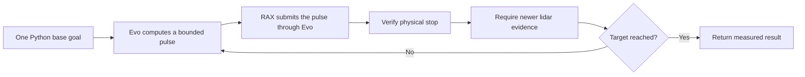
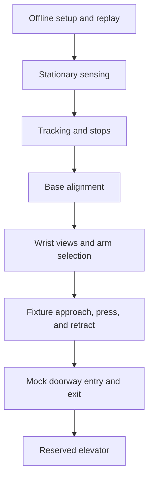

# Elevator robot test plan

Status: planned. This document does not record physical test completion or
qualified operating limits. Start with a lab button panel and mock doorway,
then use an elevator reserved for supervised testing. Select the robot and site
before deployment.

This plan applies to the Python primitives in [RAX PR #2](https://github.com/Kovari-Industries/rax/pull/2)
and the Rust services in [Evo PR #1299](https://github.com/Kovari-Industries/evo/pull/1299).
Record the exact deployed revisions for each run. See the
[primitive guide](ELEVATOR_PRIMITIVES.md) for interfaces and configuration.

## Command size and control behavior

Use task-scale goals for the main trials. Distances and angles in this table are
amounts per high-level primitive call. They are not speed limits or the size of
an internal control update. A smaller movement can be used for an initial
direction check if the operator needs it; it is not a restriction on later calls.

| Primitive | Main trial command | Basis for extension |
|---|---|---|
| Base translation | 0.25–0.5 m, forward, reverse, and lateral | Then use the distance needed for alignment or crossing, within the configured motion and time limits. |
| Base rotation | 30–90°, in both directions | Then use the turn needed to face the exterior or interior panel, within configured limits. |
| Carriage alignment | Complete move to the measured target height | Verify tracking and clearance across the intended height range. |
| Arm viewing posture | Complete calibrated bent-elbow pose | Verify the swept arm path, final posture, and wrist-camera view. |
| Button approach | Larger movement through verified clear space, followed by short observed steps near contact | Set gaps and step sizes from measured target uncertainty and available clearance. |
| Button press | Stroke derived from measured button travel | Qualify contact on a test fixture before using an elevator panel. |

Set speed and acceleration limits from tracking and stop tests. Do not treat the
software ceilings as operating targets. Do not split an otherwise valid task goal
into small operator-issued commands solely to meet an arbitrary movement size.

The current base controller stops between pulses. Measure total travel time,
pulse count, vibration, wheel steering behavior, and tracking error. A large
high-level goal does not make this motion continuous. If repeated stops make
traversal unreliable or too slow, stop that qualification stage and review the
controller; do not bypass its freshness, deadline, or stop checks.

## Preparation

- Create and validate a dedicated live agent profile. The shipped agent profile
  uses mock hardware. Check actuator modes, joint limits, collision exclusions,
  exclusive command ownership, recorder operation, and the session root/socket.
- Record measured camera intrinsics, sensor-to-robot transforms, pressing-tip
  transforms, label-to-press offsets, arm viewing poses, carriage targets, and the
  complete compact robot envelope. Include attachments in that envelope.
- Review the [earlier physical trial record](../evo_trials_2026_10_20.md). It reports
  arm-tracking errors and a base-controller activation failure. Obtain fresh
  evidence on the selected robot before contact or navigation trials. Do not
  increase torque or relax tolerances to conceal a tracking failure.
- Build Evo and install the RAX environment, robot model, sensor drivers, local
  detector model cache, inference engines, calibration, and task profiles before
  leaving network coverage. Run the stored Python task without a cloud agent.
- Assign an operator to the stop controls and an observer to clearance and external
  measurements. Check disarm, emergency stop, and the supported recovery procedure.
  Support the arms during actuator shutdown where the hardware procedure requires it.
- Define acceptance limits before each stage. Set the clearance budget from measured
  stopping distance and combined sensing, calibration, tracking, and envelope error.
  Set button targeting accuracy from the usable button area and pressing-tip size.

Run sensor replay in an isolated environment before live motion. Keep its
controller, recorder, arming, and sensor channels separate from the physical robot.
The current elevator transport and generic simulation profile use different local
router ports; resolve the test topology without allowing a remote endpoint.

| Current transport | Router port |
|---|---:|
| Elevator perception client on loopback | 7447 |
| Shipped generic agent simulation profile | 17447 |

An isolated host or network namespace can provide the required local router for
replay. Do not enable the elevator service in the generic simulation profile and
assume that its router configuration already matches.

## Test stages and gates

| Stage | Procedure | Gate to proceed |
|---|---|---|
| Offline startup and replay | Disconnect internet access while preserving local robot communication and stop controls. Start required services from stopped state. Run sensor, detector, model, and status queries. Replay changing doors and unavailable sensor evidence. | All required assets load locally. No download, cloud call, or upstream router is required. Missing assets and invalid evidence produce a refusal. |
| Stationary sensing | While disarmed, compare panel position, doorway width, floor height, and button positions with independent measurements. Check timestamps, frame identities, and depth support. Observe open, closed, partly open, obstructed, and poorly observed doorways. | Correct labels and coordinate directions. No false-open result. Missing or stale evidence does not authorize motion. Lidar wall geometry constrains heading in the intended area; parallel walls alone are not sufficient. |
| Tracking and stops | Check stationary holds and base-controller activation. Test carriage and arm motion in free space. Measure actual tip movement independently of FK. Test cancel and disarm during bounded motion in clear space. | Correct movement direction, acceptable tracking error, no uncontrolled drift, and physical stop confirmed by feedback and external observation. |
| Base motion and alignment | Keep both arms and carriage in the measured compact posture. Test the translation and rotation goals above. Then use `align_base_angle`, `align_base_distance`, and `align_base_lateral`. Extend to the turns needed for the actual panel layout. | Independent position and yaw measurements meet the declared tolerances. Full-body clearance is maintained. Lost lidar reference causes refusal and stop; wheel yaw is not substituted. Travel time and pulse behavior are acceptable. |
| Wrist views and arm selection | Use `prepare_button_view`, `search_button`, and `select_press_arm`. Test each arm alone, both feasible, only one feasible, and neither feasible. Vary panel height, side, lighting, and starting heading. Verify carriage alignment without contact. | Correct label and press point. Measured elbow bend and all viewing joints reach their targets. Approach, press, and retract previews pass for the chosen arm. If neither arm is feasible, return a refusal or reposition request. |
| Fixture button press | Use a compliant button fixture with independent contact-force measurement. Run alignment and approach separately, then one press and retraction. Set stroke and dwell from measured fixture behavior. Test interruption before contact, then a controlled interruption near contact after recovery has been checked. | Targeting and contact loads meet the declared fixture limits. The tip retracts along the verified panel normal. No base, carriage, or stow movement occurs while contact is unresolved. An uncertain press is not retried. |
| Mock doorway | Test `wait_for_door_open`, alignment, entry, and exit. Vary starting offset and yaw, opening width, obstacles, floor coverage, and measured sill geometry. Use replay and a controlled mock doorway for closure during traversal. | Motion starts only after stable open evidence. Closure, obstruction, or lost evidence stops motion. Independent measurements confirm clearance of the complete robot, not only its center. |
| Reserved elevator | Test the outside panel first. Test entry and exit with doors held open through the facility's approved procedure. Then test the turn and wrist view for the inside panel. Combine only the stages that have passed. | Repeatable completion without contact with jambs or doors. An operator confirms button activation and floor arrival. Automatic floor recognition and unattended rides are outside this qualification. |

Do not deliberately close a real elevator door onto the robot. Test recovery from
an interrupted crossing on the mock doorway before using the reserved elevator.
The arm primitives have no force control or general arm-to-scene collision model;
model preview does not establish clearance from the panel or nearby objects.

## Fault tests and recovery

Inject each fault in replay first. Repeat the applicable case during bounded
motion in clear space after the stop procedure has passed. Do not use contact or
an occupied real doorway for the first fault trial.

| Fault | Required response |
|---|---|
| Stale or missing point cloud; invalid source frame; lost lidar reference | Refuse the next pulse or stop the active action. Do not infer free space or switch to wheel-only arrival. |
| Missing detector assets; delayed or unavailable detector | Refuse targeting. A pending detection must not block cancel or hold. |
| RAX disconnect or lost lease | Evo stops independently. No command resumes on reconnect. |
| Expired drive deadline | Evo requests a stop when command validity expires. Measure stop latency and confirm physical stop; do not refresh and retry the stale pulse. |
| Recorder loss or disarm | Withdraw command authority and verify stop. |
| Cancel while dispatch is pending | Reconcile any late acceptance, stop it, and prevent the next task stage. |
| Door closes or an obstacle enters the planned path | Stop and report failure. Do not report successful crossing while any part of the robot remains in the doorway. |
| Unconfirmed stop or interrupted press | Block further task progression. Inspect the physical state and use the checked recovery procedure. No automatic retry. |

After an interrupted approach or press, establish the stopped state and inspect
clearance before explicit retraction. Do not stow, move the carriage, or move the
base first. Retain the first failed attempt and its evidence. If calibration,
limits, software, or the recovery procedure changes, repeat the affected stage.

## Acceptance and evidence

The repetition count below is a proposed commissioning gate, not a statistical
reliability claim. Test both base directions, both selected arms where configured,
and both entry and exit. Cover the measured site conditions, not only the easiest
starting pose.

| Acceptance item | Proposed requirement |
|---|---:|
| Consecutive passes for each tested condition before expanding it | 5 |
| Wrong-button selections in the acceptance set | 0 |
| False-open decisions in the acceptance set | 0 |
| Unverified stops accepted as completion | 0 |
| Automatic retries after uncertain presses | 0 |

For every attempt, retain:

- Robot identity, site, software revisions, model release, complete configuration,
  calibration IDs, and the declared acceptance limits.
- MCAP sensor and feedback data, exact detector images, detection results, scene
  and action IDs, base residuals, stop results, and failure reasons. Confirm that
  the recorder actually includes each configured cloud source and camera.
- Independent position/yaw and arm-tip measurements, stopping time and distance,
  minimum clearance, contact measurements where applicable, and operator notes.
- Total task time, pulse count, any steering oscillation or vibration, and button
  activation recorded separately from stroke completion.

Record every result as pass, fail, or not run. The current detector cannot prove
activation: `stroke_complete_unconfirmed` remains the software result even when
an operator observes that the button activated.

The first robot session covers offline startup, stationary sensing, tracking,
and stop checks. Use the task-scale base goals once those checks pass. Schedule
fixture contact and doorway trials after review of that evidence.
