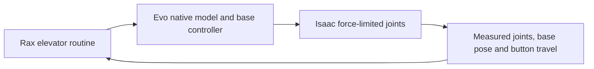
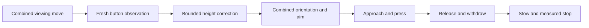

# Isaac elevator validation

The ML `packages/evo_isaac/scripts/navigation_trial.py` runner loads this checkout
and calls the existing elevator routines. `SimulationElevator` accepts only a
context with `simulated: true` and `scene.observation_source:
simulator_ground_truth`. Each button observation must repeat that source.
A live robot context cannot use this class.



The simulation adapter supplies a clock which advances physics during door waits
and press dwell. Observation age still uses the capture wall clock. This prevents
a slow simulation from using a wall-time wait as a substitute for simulated dwell.
The default live clock is unchanged.

A press is successful only when activation verification reports success. The
simulation verifier requires one event for the requested button and release.
The live verifier still reports unknown until a qualified activation detector is
available. Native action failure continues to stop the routine.

Press preparation uses a bound on the actual orientation change of the tool.
An unchanged orientation requires no rotational clearance. A nonzero rotation
still requires clearance for the tool offset along the shortest orientation arc.

The current ML pilot uses an assumed palm stylus, a planar base, fixture geometry,
and model gravity compensation as an explicit control option. These observations
do not establish camera perception, a real tool calibration, tipping stability,
or transfer to hardware. See the ML campaign report for measured outcomes and
immutable evidence links. Failed runs remain failures.

The [ML Hilton reference](https://github.com/Kovari-Industries/ml/blob/benson/rax-isaac-elevator-navigation/packages/evo_isaac/docs/HILTON-REFERENCE.md)
uses the user-supplied UH and Texas Lodging maps. It selects the north-wing guest
elevator and keeps the adjacent garage shaft distinct. The first- and second-floor
profiles retain source hashes and map assumptions. Metric sizes and the test panel
remain assumed. The same added walls feed physical collision and the privileged
navigation geometry. A plotted lobby route is not a completed robot run.

The campaign saves raw state, USD scenes, phase images, sampled GIF/MP4 replays,
and verified S3 archive hashes. A local straight-motion control passes with the
native travel and measured-stop checks. Lateral controls also pass after a measured
steering-stop repair. Direction changes and the combined button/entry/exit task
remain under test. This is simulation evidence only.

Run focused task checks from the Rax root:

```sh
uv run --with pytest --with jinja2 --with numpy --with pillow python -m pytest -q \
  local_tests/unit/test_elevator.py local_tests/unit/test_elevator_sim.py \
  local_tests/unit/test_evo_motion.py
```


`ElevatorSettings.direct_doorway_staging=True` opts into a direct staging path.
After facing the door, Rax approaches a point centered before the sill in steps
of at most 0.15 m. Every step uses fresh geometry, native preview and measured
stop checks. The total alignment budget remains 1 m. Clearance refusal stops the
routine. The default staging mode remains unchanged. This option is under Isaac
validation after sideways-to-forward controls exceeded a heading-travel bound;
it does not qualify arbitrary direction changes or physical operation.

### Full button-action timing target

The target is less than 20 simulated seconds from task start through correct
activation, release, withdrawal, arm stow and the final measured stop. About
10 seconds is the stretch target. Activation time alone does not satisfy it.
Earlier physical passes remain valid for their original checks, but do not
establish this new timing target.

Two preparation controls default to `False`:

| Setting | Change | Checks retained |
|---|---|---|
| `synchronized_view` | Send carriage and selected viewing-arm targets in one `evo_move_joints` action | One matching preview; measured stop; carriage and each arm endpoint |
| `direct_press_alignment` | Combine press orientation and lateral aim after bounded carriage correction | Fresh observations; original gap and orientation-sweep check before and after correction; tip endpoint |



The existing `segment_s` setting controls Cartesian path duration. These controls
do not change its default, the approach step, stroke, dwell, gain, source motion
limits or stop thresholds. Preview refusal has no fallback path. Deterministic
tests cover success, rejected previews, missing stops, wrong endpoints and loss
of preparation clearance. Simulator timing qualification is pending.

The separate [interior cabin routine](CABIN_NAVIGATION.md) adds the new sequence:
origin OCR and pressure baseline, one exterior hall call if needed, entry,
checked turnaround, inside floor-panel press with arm selection, destination
OCR plus barometer verification, then forward exit. Its CPU contract checks do
not change or reclassify earlier simulation evidence.
