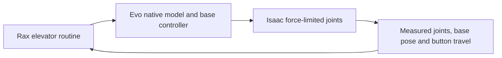

# Isaac elevator validation

The ML `packages/evo_isaac/scripts/navigation_trial.py` runner loads this checkout
and calls the existing elevator routines. `SimulationElevator` accepts only a
context with `simulated: true` and `scene.observation_source:
simulator_ground_truth`. Each button observation must repeat that source.
A live robot context cannot use this class.



The simulation adapter supplies a clock which advances physics during door waits
and press dwell. Observation age still uses the capture wall clock. This prevents
a slow simulation from using a wall-time wait as a substitute for simulated dwell.
The default live clock is unchanged.

A press is successful only when activation verification reports success. The
simulation verifier requires one event for the requested button and release.
The live verifier still reports unknown until a qualified activation detector is
available. Native action failure continues to stop the routine.

Press preparation uses a bound on the actual orientation change of the tool.
An unchanged orientation requires no rotational clearance. A nonzero rotation
still requires clearance for the tool offset along the shortest orientation arc.

The current ML pilot uses an assumed palm stylus, a planar base, fixture geometry,
and model gravity compensation as an explicit control option. These observations
do not establish camera perception, a real tool calibration, tipping stability,
or transfer to hardware. See the ML campaign report for measured outcomes and
immutable evidence links. Failed runs remain failures.

Run focused task checks from the Rax root:

```sh
uv run --with pytest --with jinja2 --with numpy --with pillow python -m pytest -q \
  local_tests/unit/test_elevator.py local_tests/unit/test_elevator_sim.py \
  local_tests/unit/test_evo_motion.py
```
