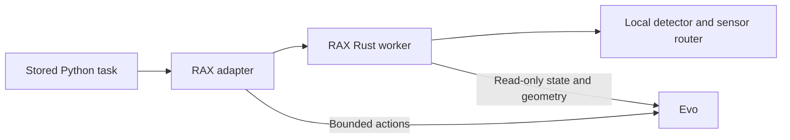

# Local elevator runtime

This Rust process belongs to RAX. It computes scene geometry, lidar pose, doorway
state, button rays, and base velocity requests. It cannot command actuators.
The trusted Python adapter sends deadline-bound pulses through Evo's existing
session. Python also composes arm, carriage, and press actions.



## Build and deployment

Install a Rust toolchain that meets `Cargo.toml` and fetch dependencies before the
robot leaves network coverage. Build for the robot's architecture:

```bash
cargo fetch --manifest-path services/elevator_runtime/Cargo.toml --locked
cargo build --manifest-path services/elevator_runtime/Cargo.toml --release --locked --offline
cargo test --manifest-path services/elevator_runtime/Cargo.toml --locked --offline
```

Deploy `target/release/rax-elevator-runtime` and its measured JSON configuration.
The binary does not run Cargo or download files. Configure the RAX backend with
absolute `elevator_binary` and `elevator_config` paths. The adapter starts the
worker and gives it a private Unix socket. Do not expose that socket to the agent.

The configuration has exactly three fields: `scene`, `button_service`, and
`ros_domain_id`. The scene fields and calibration requirements are listed in
[the primitive guide](../../docs/evo/ELEVATOR_PRIMITIVES.md#configuration).
Use the installed service name, normally `/button_recognition/detect`.
Do not deploy the synthetic calibration from the unit tests.

## Offline operation

The worker connects to `tcp/127.0.0.1:7447`. Multicast and gossip discovery are
disabled. It has no remote endpoint or DNS dependency. The local robot router
must serve the sensor topics and detector service without an upstream router.
Configure that router independently for offline operation.

The adapter removes `ZENOH_CONFIG_OVERRIDE` and `ZENOH_SESSION_CONFIG_URI` from
the child environment. Direct worker startup rejects those variables so they
cannot redirect its transport. Evo state and motion use private Unix sockets.

Use Evo's existing button recognition models. Run `kb prepare models` in Evo
before deployment, then verify the detector starts with the prepared release,
model cache, and inference engines. The detector refuses missing or mismatched
assets; the primitive has no download or cloud fallback. Install sensor drivers,
calibration, robot model files, the RAX environment, and task profiles locally.
A stored Python task selects the arm from path feasibility and measured geometry;
it does not require an LLM. A local model can be added for another perception task
only if its assets are also installed and its output passes the same motion checks.

Test with internet disconnected before a physical trial. Cargo's offline test
option checks dependency availability; it does not prove sensor coverage or
physical stopping performance.

## Interface source

The three files under `interfaces/evo_interfaces` are copied from Evo commit
`7dfdbbb80` (PR 1299 base for this change). They define the existing detector wire
contract. `build.rs` generates only those interfaces; standard sensor messages
come from the pinned Hiroz dependency. Runtime deployment does not require an Evo
source checkout or a ROS code generator.
